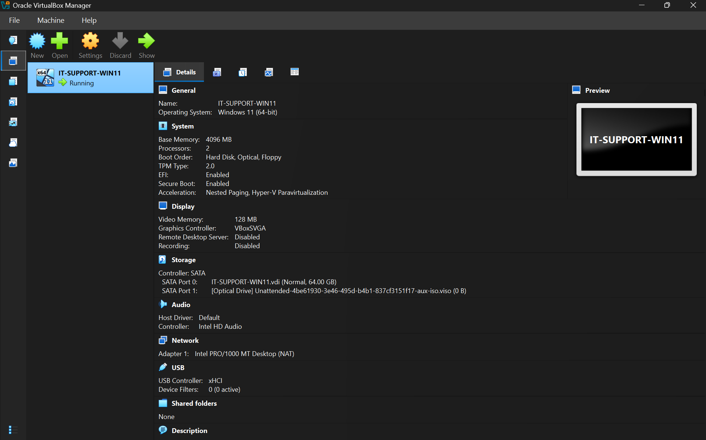

# Windows & Network Troubleshooting Lab

**Hands-On IT Support | Windows Administration | Network Diagnostics | Technical Troubleshooting**

A Windows 11 virtual lab designed to simulate, diagnose, and resolve common IT support incidents. Completed seven hands-on troubleshooting scenarios involving network connectivity, Windows services, user access permissions, and system performance.

Each scenario includes diagnostic testing, root-cause analysis, corrective actions, and screenshot evidence of the results.

**Project Status:** Completed 7 hands-on IT support troubleshooting scenarios
---

## Project Overview

Built a Windows 11 Pro virtual workstation using Oracle VirtualBox to practice the technical responsibilities commonly associated with Help Desk, Desktop Support, and IT Support Technician positions.

The lab follows a structured incident-resolution process: establish a working baseline, reproduce a technical issue, collect diagnostic evidence, identify the cause, apply a targeted fix, and verify the result.

All incidents were intentionally simulated in a personal lab environment.

### Project Highlights

- Completed **7 Windows and network troubleshooting scenarios**.
- Diagnosed DNS failures, incorrect IPv4 configurations, DHCP failures, and disabled network adapters.
- Investigated and recovered a stopped Windows Print Spooler service using PowerShell.
- Configured and verified least-privilege NTFS access for a standard user.
- Identified a PowerShell workload consuming 31.2% CPU and verified total CPU utilization decreased from 35% to 3% after stopping it.
- Captured technical evidence throughout the troubleshooting and recovery process.

## Troubleshooting Case Studies

Each case study documents the simulated incident, diagnostic commands, observed results, root cause, corrective actions, and verification evidence.

| Ticket | Incident | Technical Skills | Verified Outcome |
|---|---|---|---|
| [001 — DNS Resolution Failure](troubleshooting-cases/01-dns-resolution.md) | Nonresponsive configured DNS server | DNS, `nslookup`, TCP/IP | DNS resolution restored |
| [002 — Static IP Misconfiguration](troubleshooting-cases/02-static-ip-configuration.md) | Incorrect IPv4 address and gateway | IPv4, routing, DHCP, `ping` | Gateway and external connectivity restored |
| [003 — DHCP Failure](troubleshooting-cases/03-dhcp-failure.md) | DHCP unavailable on an isolated network | DHCP, APIPA, `ipconfig` | Automatic IPv4 addressing restored |
| [004 — Disabled Network Adapter](troubleshooting-cases/04-disabled-network-adapter.md) | Ethernet adapter disabled | Windows network administration | Adapter and connectivity restored |
| [005 — Print Spooler Service Failure](troubleshooting-cases/05-print-spooler-service.md) | Print Spooler service stopped | Windows Services, PowerShell | Service restored to Running |
| [006 — NTFS Permission Error](troubleshooting-cases/06-ntfs-file-permissions.md) | Standard user denied folder access | NTFS, `icacls`, access control | Read-only access granted and verified |
| [007 — High CPU Usage](troubleshooting-cases/07-high-cpu-usage.md) | CPU-intensive background process | Task Manager, PowerShell | CPU usage returned to low levels |

## Lab Environment

| Component | Configuration |
|---|---|
| Virtualization | Oracle VirtualBox |
| Operating System | Windows 11 Pro, 64-bit |
| Workstation | `IT-SUPPORT-PC01` |
| Memory | 4 GB RAM |
| Virtual Storage | 64 GB |
| Primary Network Mode | NAT |
| Baseline IPv4 Address | `10.0.2.15` |
| Subnet Mask | `255.255.255.0` |
| Default Gateway | `10.0.2.2` |
| DNS Server | `10.0.0.1` |

The lab used a virtualized environment to isolate simulated troubleshooting problems from the host computer. VirtualBox snapshots provided a recovery point before network configuration changes.

### Virtual Machine Configuration

### Windows 11 Workstation

## Tools & Technologies

| Category | Tools and Technologies |
|---|---|
| Operating Systems | Windows 11 Pro |
| Virtualization | Oracle VirtualBox, snapshots, NAT, internal networking |
| Network Diagnostics | `ipconfig`, `ping`, `nslookup` |
| Network Fundamentals | IPv4, TCP/IP, DNS, DHCP, default gateways, subnetting |
| System Administration | Windows Services, local user accounts, NTFS permissions |
| Command-Line Administration | Command Prompt, PowerShell, `icacls` |
| Performance Analysis | Windows Task Manager, `Get-Job`, `Stop-Job` |

## Troubleshooting Methodology

A consistent process was followed throughout the lab:

1. **Establish a baseline:** Examine the workstation's normal configuration and confirm functionality before introducing changes.
2. **Reproduce the incident:** Simulate a technical problem in the virtual environment.
3. **Collect diagnostic evidence:** Use Windows administrative tools and command-line utilities to examine symptoms.
4. **Isolate the cause:** Compare failed and successful tests to identify the misconfiguration, unavailable service, or resource-intensive process.
5. **Apply a corrective action:** Restore appropriate network settings, service states, or file permissions.
6. **Verify the resolution:** Repeat relevant tests and confirm that the original problem has been resolved.
7. **Document the findings:** Preserve screenshots, commands, observed results, and technical explanations for each case study.

## Selected Technical Findings

### DNS and Network Connectivity

Demonstrated that successful communication with an external IP address does not necessarily mean DNS resolution is functioning. A DNS query to the intentionally misconfigured server timed out while external IPv4 connectivity remained available.

### DHCP and Automatic Addressing

Reproduced DHCP unavailability by isolating the virtual workstation from its normal DHCP service. Windows assigned an APIPA address of `169.254.88.53`. Restoring NAT networking allowed the workstation to obtain its normal IPv4 configuration again.

### NTFS Access Control

Created a standard employee account and reproduced a folder access restriction. Used Windows security settings and `icacls` to investigate and adjust permissions, then verified the employee could read a document but could not append changes to it.

### CPU Performance Investigation

Generated a temporary CPU workload using PowerShell. Task Manager identified the resource-intensive process at 31.2% CPU. After stopping the background job, total CPU usage decreased from 35% to 3%.

## Challenges and Lessons Learned

Several exercises required troubleshooting beyond the originally planned simulation.

During the NTFS permissions scenario, Windows encountered an error while applying folder permissions. Further investigation using `icacls` helped manage the permissions directly. A filename mismatch also caused an initial command failure and required checking the actual file path.

These issues reinforced several practical habits:

- Verify the exact configuration before making changes.
- Read command output carefully instead of assuming an operation succeeded.
- Check filenames, paths, account identities, and effective permissions.
- Retest functionality after applying a correction.
- Record unexpected failures alongside the intended troubleshooting results.

## Scope and Limitations

This project documents simulated support incidents in a controlled Windows virtual machine. It does not represent production IT administration or support work performed for real employees.

The Print Spooler scenario verified recovery of the Windows service; an actual physical printing operation was not tested. The performance scenario used a controlled PowerShell workload rather than an uncontrolled application failure.

## Conclusion

Completed seven simulated IT support incidents covering Windows networking, service management, file permissions, and performance diagnostics.

The project demonstrates hands-on practice with a repeatable troubleshooting process, supported by command outputs, configuration screenshots, and verified recovery results.

Detailed technical reports are maintained in the `troubleshooting-cases/` directory.
