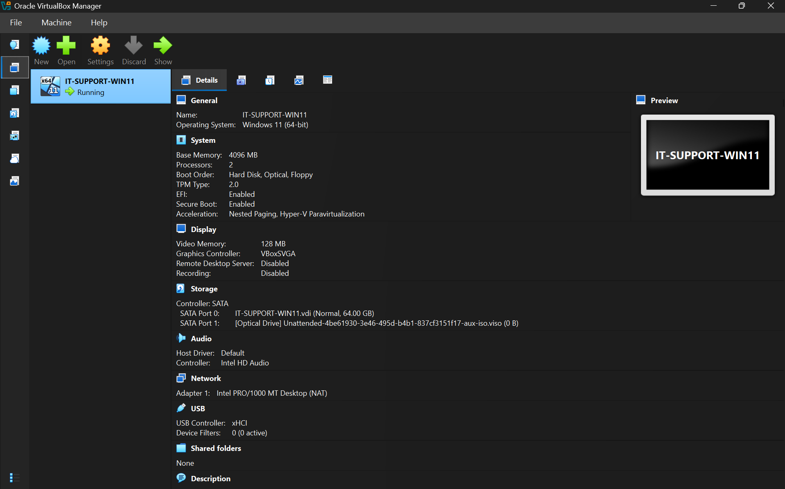

# Windows & Network Troubleshooting Lab

## Project Overview

This project is a hands-on IT support troubleshooting lab built using Windows 11 Pro and Oracle VirtualBox. The lab simulates common technical support incidents involving network connectivity, Windows services, file permissions, and system performance.

The objective was to develop practical troubleshooting skills by intentionally introducing technical problems, diagnosing their causes, applying corrective actions, and verifying successful resolutions.

Seven simulated IT support tickets were completed, with screenshots documenting the configuration, diagnostic process, failures, and solutions.

**Project Status:** Completed — 7/7 troubleshooting cases

## Lab Environment

| Component | Configuration |
|---|---|
| Virtualization Platform | Oracle VirtualBox |
| Operating System | Windows 11 Pro (64-bit) |
| Workstation Name | IT-SUPPORT-PC01 |
| Memory | 4 GB RAM |
| Storage | 64 GB virtual disk |
| Network Configuration | NAT |
| IPv4 Address | 10.0.2.15 (DHCP-assigned baseline) |
| Default Gateway | 10.0.2.2 |
| DNS Server | 10.0.0.1 |

The Windows 11 virtual machine provided a controlled environment for reproducing technical support problems without changing the network settings of the host computer.

### Virtual Machine Configuration

### Windows 11 Environment

## Tools & Technologies

- **Windows 11 Pro:** Operating system administration and desktop troubleshooting
- **Oracle VirtualBox:** Virtualization, network configuration, and snapshots
- **Command Prompt:** Network diagnostic commands and troubleshooting
- **PowerShell:** Windows service management and CPU workload testing
- **TCP/IP:** IPv4 addressing, subnet masks, and default gateways
- **DNS:** Domain name resolution testing and troubleshooting
- **DHCP:** Automatic IP configuration and renewal
- **Windows Services:** Background service investigation and recovery
- **NTFS Permissions:** File access control and least-privilege permissions
- **Task Manager:** CPU and memory monitoring
- **ICACLS:** Command-line management and inspection of file permissions

## Initial Network Verification

Before simulating technical problems, I established a working network baseline.

Using `ipconfig /all`, I examined the workstation's IP configuration, subnet mask, default gateway, DHCP settings, and DNS server.

I then used `ping` to test communication with the default gateway and an external IP address, followed by `nslookup` to verify DNS resolution.

The initial tests confirmed that the workstation had working external IP connectivity and DNS resolution.

A clean VirtualBox snapshot was created before beginning the troubleshooting exercises.

## Troubleshooting Cases

### Ticket #001 — DNS Resolution Failure

Simulated an incorrect DNS server configuration, diagnosed a failed DNS lookup, and restored automatic DNS settings. Verified that domain name resolution worked after the repair.

### Ticket #002 — Incorrect Static IP Configuration

Introduced incorrect static IPv4 and default gateway settings, investigated network connectivity failures, and restored automatic addressing through DHCP.

### Ticket #003 — DHCP Failure

Simulated DHCP unavailability using an isolated VirtualBox network. Investigated the resulting APIPA address and DHCP renewal timeout, then restored NAT networking and verified successful address assignment.

### Ticket #004 — Disabled Network Adapter

Disabled the Windows Ethernet adapter, investigated the resulting connectivity failures, and restored the network connection.

### Ticket #005 — Windows Print Spooler Service Failure

Stopped the Print Spooler service, diagnosed its status using PowerShell, restarted the service, and confirmed that it returned to a running state.

### Ticket #006 — NTFS File & Folder Permissions

Created a standard employee account and restricted access to a test document. Reproduced an access-denied error, investigated NTFS permissions using ICACLS, and restored read-only access while preventing file modifications.

### Ticket #007 — High CPU Usage

Created a controlled PowerShell CPU workload, identified the resource-intensive process using Task Manager, stopped the background job, and verified that CPU usage decreased.

## Troubleshooting Methodology

Each incident followed a consistent troubleshooting process:

1. **Identify the problem:** Understand the reported symptoms.
2. **Investigate:** Examine system settings, diagnostic results, and relevant Windows tools.
3. **Determine the cause:** Use the collected evidence to identify the misconfiguration or failure.
4. **Apply a solution:** Correct the problem using the appropriate administrative tools.
5. **Verify the resolution:** Repeat relevant tests to confirm that functionality was restored.
6. **Document the incident:** Record the findings, corrective actions, and supporting screenshots.

## Skills Developed

- Windows 11 administration and troubleshooting
- IPv4 addressing and network connectivity diagnostics
- DNS and DHCP troubleshooting
- Command Prompt and PowerShell usage
- Windows service management
- NTFS permissions and user access control
- CPU and memory performance monitoring
- Technical documentation and root-cause analysis

## Project Documentation

Detailed troubleshooting reports and supporting screenshots are maintained in the `troubleshooting-cases/` and `screenshots/` directories.

Each case report includes the reported issue, diagnostic commands, findings, root cause, corrective actions, and verification evidence.

## Conclusion

This lab provided practical experience diagnosing and resolving common Windows and network problems in a simulated IT support environment.

The exercises reinforced the importance of verifying symptoms, examining system configurations, identifying root causes, and testing solutions before closing a support ticket.
