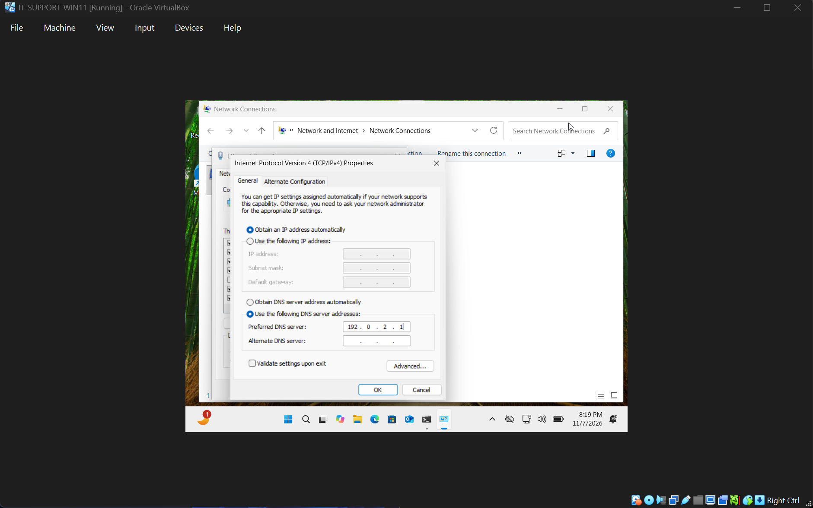
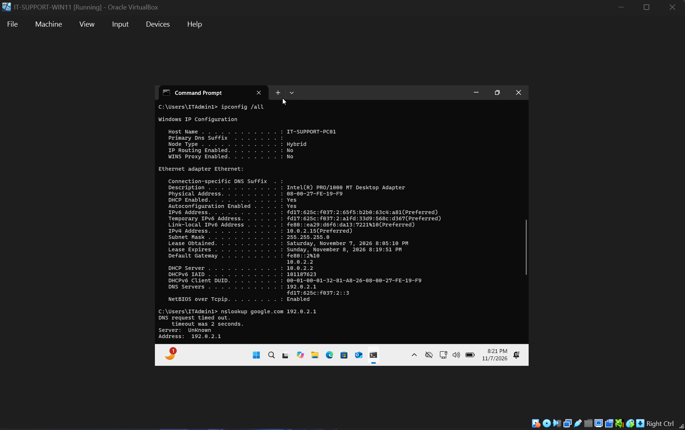
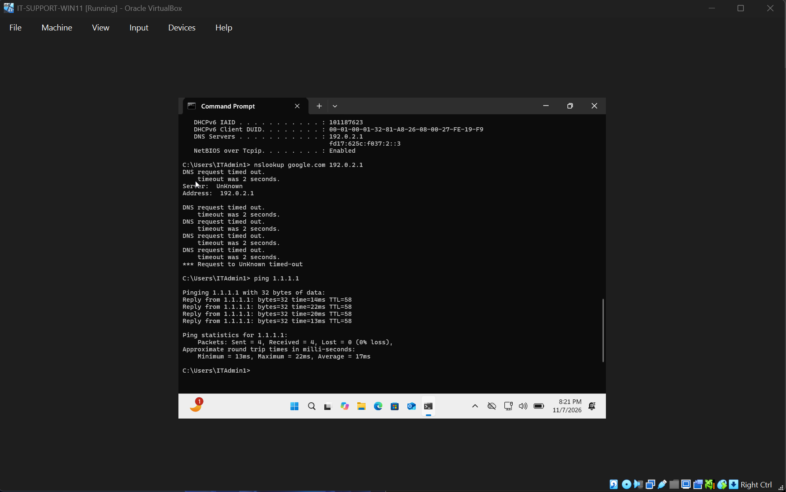
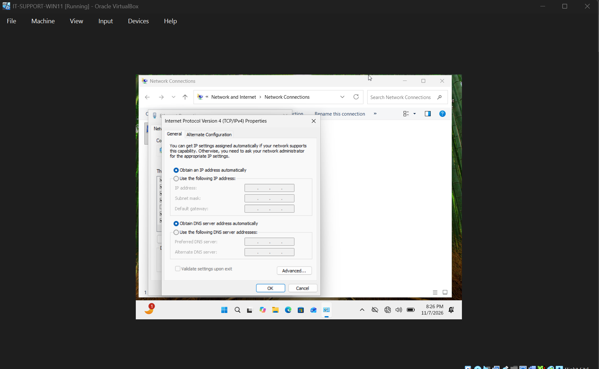
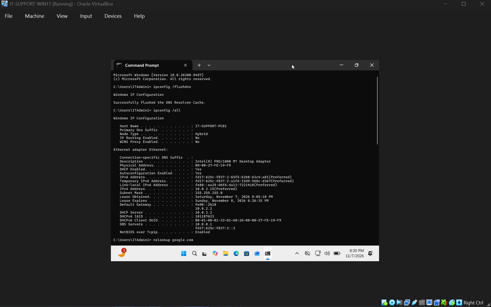
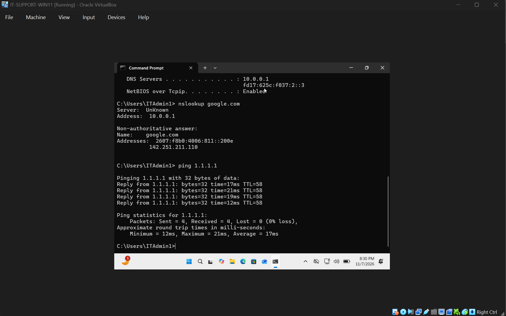

# Ticket 001 | DNS Resolution Failure

**Incident Category:** Network Troubleshooting — DNS

**Environment:** Windows 11 Pro | Oracle VirtualBox

**Workstation:** `IT-SUPPORT-PC01`

**Incident Type:** Simulated IT Support Ticket

**Final Status:** Resolved and Verified

---

## 1. Incident Summary

### Problem Description

A Windows 11 workstation was intentionally configured with an incorrect IPv4 DNS server to simulate a desktop support incident involving failed DNS queries.

The objective was to investigate the network configuration, determine whether external IP connectivity remained functional, isolate the cause of the DNS failure, and restore the correct network settings.

### Resolution Summary

Identified a manually configured DNS server (`192.0.2.1`) that failed to respond to DNS queries.

Diagnostic testing confirmed that the specified DNS server timed out while the workstation maintained successful external IPv4 connectivity.

Restored automatic DNS configuration, cleared the local DNS resolver cache, and verified that domain-name resolution functioned successfully after the corrective action.

## 2. Technical Environment

| Component | Configuration |
|---|---|
| Operating System | Windows 11 Pro (64-bit) |
| Virtualization Platform | Oracle VirtualBox |
| Workstation Name | `IT-SUPPORT-PC01` |
| Network Adapter | Ethernet |
| VirtualBox Network Mode | NAT |
| IPv4 Address | `10.0.2.15` |
| Subnet Mask | `255.255.255.0` |
| Default Gateway | `10.0.2.2` |
| Working IPv4 DNS Server | `10.0.0.1` |
| Incorrect IPv4 DNS Server | `192.0.2.1` |

The workstation was configured with a working network connection before the incident was reproduced.

The test was performed within an isolated virtual machine environment to avoid modifying the host computer's network configuration.

## 3. Incident Reproduction

### Step 1 — Introduce the DNS Misconfiguration

Opened Windows network adapter settings using:

`ncpa.cpl`

Navigated to:

**Ethernet → Properties → Internet Protocol Version 4 (TCP/IPv4)**

Changed the DNS configuration from automatic assignment to a manually specified preferred DNS server:

`192.0.2.1`

This address belongs to a range reserved for documentation and testing and was used to simulate a nonresponsive DNS server.

The IPv4 address and default gateway settings were left unchanged so that the investigation could focus on DNS resolution.

### Evidence 01 — Initial DNS Misconfiguration

**Observation:** The network adapter was manually configured to query an incorrect DNS server.

## 4. Diagnostic Investigation

### Step 2 — Inspect the Workstation's Network Configuration

**Command:**

`ipconfig /all`

**Purpose:**

Inspect the workstation's current TCP/IP configuration, including its IPv4 address, subnet mask, default gateway, and DNS server settings.

**Observed results:**

| Network Parameter | Observed Value |
|---|---|
| IPv4 Address | `10.0.2.15` |
| Subnet Mask | `255.255.255.0` |
| Default Gateway | `10.0.2.2` |
| Manually Configured IPv4 DNS Server | `192.0.2.1` |

**Technical Analysis:**

The workstation retained its expected IPv4 address and default gateway.

This indicated that the incident had not removed the workstation's normal IPv4 addressing configuration.

However, the manually configured DNS server differed from the working network baseline, making it the primary focus of the investigation.

### Evidence 02 — DNS Configuration Investigation

**Observation:** The diagnostic evidence confirmed that the workstation was configured with the incorrect IPv4 DNS server.

### Step 3 — Test DNS Server Responsiveness

**Command:**

`nslookup google.com 192.0.2.1`

**Purpose:**

Send a DNS query directly to the suspected DNS server and determine whether it could resolve the requested domain name.

**Observed result:**

The DNS query timed out.

**Technical Analysis:**

The specified DNS server failed to respond to the lookup request.

This confirmed that `192.0.2.1` was not functioning as a usable DNS server for this test.

The command explicitly targeted `192.0.2.1`, so the result established a failure of that particular server. It did not independently prove that every DNS resolution method available to Windows was failing.

### Step 4 — Test External IPv4 Connectivity

**Command:**

`ping 1.1.1.1`

**Purpose:**

Determine whether the workstation could communicate with an external IPv4 address without relying on DNS resolution.

**Observed results:**

| Test Metric | Result |
|---|---|
| Packets Sent | 4 |
| Packets Received | 4 |
| Packets Lost | 0 |
| Packet Loss | 0% |
| Average Response Time | Approximately 17 ms |

**Technical Analysis:**

All four ICMP echo requests received successful responses.

This demonstrated that the workstation retained external IPv4 connectivity despite the incorrect DNS configuration.

Comparing the successful ping test with the failed DNS query helped distinguish a DNS server problem from a general loss of IP connectivity.

### Evidence 03 — DNS Failure and Connectivity Testing

**Diagnostic Finding:** The configured DNS server failed to respond, while external IPv4 communication remained functional.

## 5. Root Cause Analysis

### Confirmed Root Cause

**Incorrect manual IPv4 DNS server configuration.**

The workstation's preferred IPv4 DNS server was changed from its normal automatic configuration to `192.0.2.1`.

The configured address did not respond to DNS requests during testing.

### Supporting Evidence

| Evidence | Interpretation |
|---|---|
| `ipconfig /all` showed `192.0.2.1` | Confirmed incorrect manual IPv4 DNS configuration |
| `nslookup google.com 192.0.2.1` timed out | Confirmed the specified DNS server was unresponsive |
| `ping 1.1.1.1` returned 0% packet loss | Demonstrated successful external IPv4 connectivity |
| IPv4 address and default gateway remained configured | Indicated that the problem did not require changing those settings |

### Root Cause Conclusion

The evidence identified the manually configured DNS server as the cause of the observed DNS query failure.

Since external IPv4 communication was functioning, modifying unrelated IP addressing or routing settings was unnecessary.

The appropriate corrective action was to remove the incorrect manual DNS configuration and restore the workstation's normal DNS settings.

## 6. Corrective Actions

### Step 5 — Restore Automatic DNS Configuration

Returned to the Ethernet adapter's IPv4 properties:

**Ethernet → Properties → Internet Protocol Version 4 (TCP/IPv4)**

Changed the DNS setting to:

**Obtain DNS server address automatically**

This removed the incorrect preferred DNS server and allowed Windows to use the DNS configuration supplied by the normal network environment.

### Evidence 04 — DNS Configuration Restored

**Corrective Action:** Removed the manually configured DNS server and restored automatic DNS assignment.

### Step 6 — Clear the DNS Resolver Cache

Opened Command Prompt and executed:

`ipconfig /flushdns`

**Purpose:**

Clear the Windows DNS resolver cache before performing another DNS lookup.

This helps ensure that the follow-up test does not depend on a previously cached DNS response.

### Step 7 — Verify the Restored Network Configuration

Executed:

`ipconfig /all`

**Observed result:**

The incorrect manual DNS server was removed, and the working IPv4 DNS server configuration was restored to `10.0.0.1`.

The workstation retained its normal IPv4 addressing configuration.

### Evidence 05 — DNS Cache and Configuration Verification

**Observation:** The DNS cache was cleared and the restored DNS configuration was confirmed.

## 7. Resolution Verification

### Step 8 — Verify Domain-Name Resolution

**Command:**

`nslookup google.com`

**Purpose:**

Verify that the workstation could successfully resolve a domain name using its restored DNS configuration.

**Observed result:**

The DNS lookup completed successfully and returned an IP address for `google.com`.

This confirmed that domain-name resolution was functioning after the configuration change.

### Step 9 — Confirm External IPv4 Connectivity

**Command:**

`ping 1.1.1.1`

**Purpose:**

Confirm that the DNS correction did not disrupt the workstation's existing external IPv4 connectivity.

**Observed result:**

The workstation successfully received ICMP echo replies with 0% packet loss.

### Evidence 06 — Successful Resolution Verification

### Final Verification Results

| Verification Test | Expected Result | Actual Result | Status |
|---|---|---|---|
| DNS configuration | Correct DNS server restored | `10.0.0.1` restored | Passed |
| DNS resolution | Domain resolves successfully | `google.com` resolved | Passed |
| External IPv4 connectivity | Successful ICMP replies | 0% packet loss | Passed |
| Original DNS misconfiguration | Incorrect server removed | Automatic DNS restored | Passed |

**Final Assessment:** The tested DNS resolution problem was resolved, and normal external IPv4 connectivity remained functional.

## 8. Technical Skills Demonstrated

**Windows Network Administration**
- Examined and modified IPv4 DNS settings through the Windows network adapter interface.
- Restored automatic DNS configuration without changing unrelated IPv4 settings.

**Network Troubleshooting**
- Used `ipconfig /all` to inspect TCP/IP configuration.
- Used `nslookup` to diagnose an unresponsive DNS server.
- Used `ping` to independently test external IPv4 connectivity.
- Compared diagnostic results to isolate the reported problem.

**Command-Line Diagnostics**
- Executed diagnostic commands using Command Prompt.
- Cleared the DNS resolver cache using `ipconfig /flushdns`.
- Verified restored network functionality through repeat testing.

**Incident Documentation**
- Recorded the initial misconfiguration and diagnostic findings.
- Identified the root cause using observed command output.
- Documented corrective actions and post-resolution verification.

## 9. Lessons Learned

This scenario demonstrated why DNS resolution and IP connectivity must be evaluated separately when troubleshooting network issues.

A workstation can communicate successfully with external IP addresses while experiencing problems with a particular DNS server.

Using a direct DNS query alongside an external IP connectivity test helped isolate the cause without making unnecessary configuration changes.

The exercise also reinforced the importance of verifying a resolution through functional tests. Restoring a network setting is only part of the troubleshooting process; successful follow-up testing provides evidence that the corrective action worked.

## 10. Incident Closure

| Closure Requirement | Result |
|---|---|
| Incident reproduced | Completed |
| Network configuration inspected | Completed |
| DNS server failure identified | Completed |
| Root cause established | Completed |
| Corrective action implemented | Completed |
| DNS resolution verified | Passed |
| External connectivity verified | Passed |
| Evidence documented | Completed |
| **Final Status** | **Resolved and Verified** |

---

**Project:** Windows & Network Troubleshooting Lab

[Return to Main Project README](../README.md)
