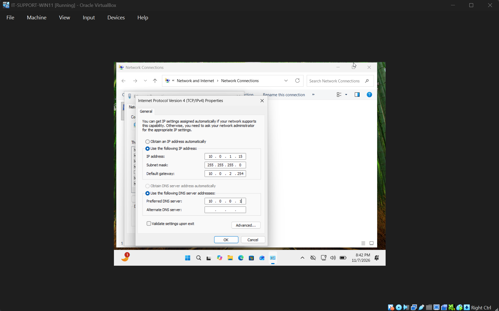
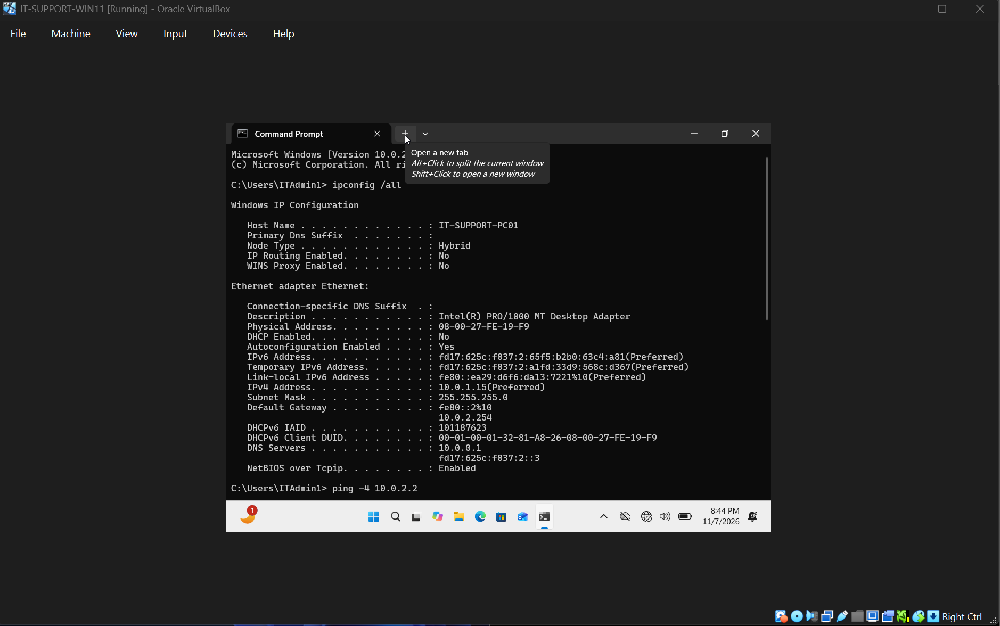
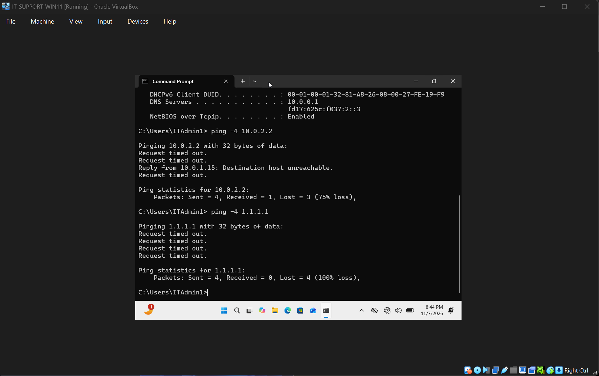
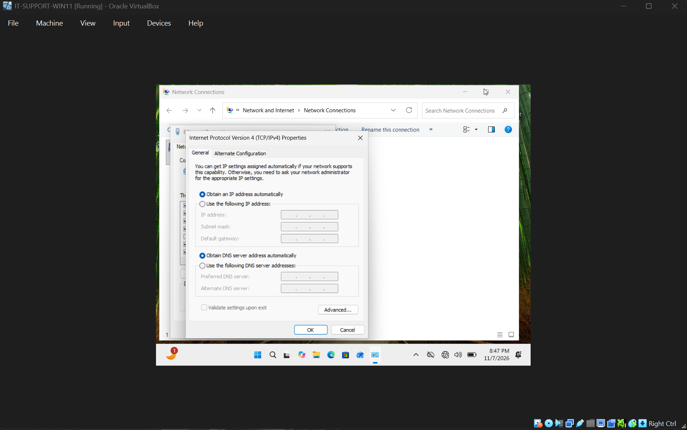
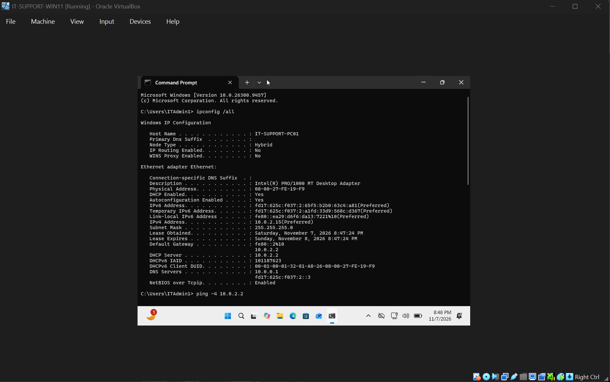
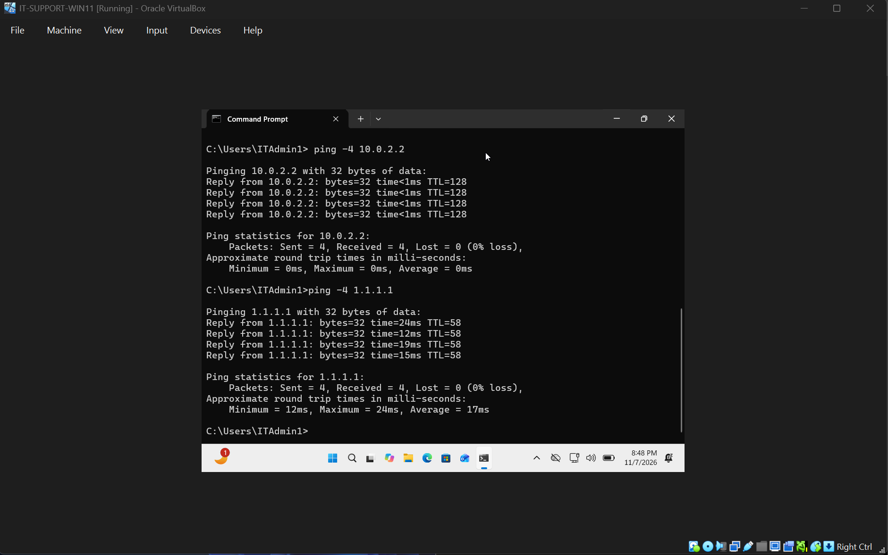

# Ticket 002 | Incorrect Static IP Configuration

**Incident Category:** Network Troubleshooting — IPv4 Addressing & Routing

**Environment:** Windows 11 Pro | Oracle VirtualBox

**Workstation:** `IT-SUPPORT-PC01`

**Incident Type:** Simulated IT Support Ticket

**Final Status:** Resolved and Verified

---

## 1. Incident Summary

### Problem Description

A Windows 11 workstation was intentionally configured with an incorrect static IPv4 address and default gateway to simulate a common IT support incident involving loss of network connectivity.

The workstation originally received its network configuration automatically through DHCP. To reproduce the incident, the automatic addressing configuration was replaced with manually assigned values that did not match the virtual network.

The objective was to investigate the resulting connectivity failure, identify the incorrect TCP/IP settings, restore valid network configuration, and verify communication with the local gateway and an external IPv4 address.

### Resolution Summary

Identified two incorrect network settings:

- **Static IPv4 address:** `10.0.1.15`
- **Default gateway:** `10.0.2.254`

The assigned IPv4 address placed the workstation in a different subnet from its normal VirtualBox NAT network. The configured gateway was also incorrect and outside the workstation's assigned `/24` subnet.

Diagnostic testing showed that the workstation could not successfully communicate with the known-working gateway or an external IPv4 address.

Restored automatic IP and DNS configuration, confirmed successful DHCP assignment, and verified that local and external IPv4 connectivity were functioning again.

## 2. Technical Environment

| Component | Configuration |
|---|---|
| Operating System | Windows 11 Pro (64-bit) |
| Virtualization Platform | Oracle VirtualBox |
| Workstation Name | `IT-SUPPORT-PC01` |
| Network Adapter | Ethernet |
| VirtualBox Network Mode | NAT |
| Expected IPv4 Address | `10.0.2.15` |
| Expected Subnet Mask | `255.255.255.0` |
| Expected Default Gateway | `10.0.2.2` |
| Expected DNS Server | `10.0.0.1` |
| Normal Address Assignment | DHCP |

### Network Configuration Comparison

| Network Parameter | Working Configuration | Incorrect Static Configuration |
|---|---|---|
| IPv4 Address | `10.0.2.15` | `10.0.1.15` |
| Subnet Mask | `255.255.255.0` | `255.255.255.0` |
| Default Gateway | `10.0.2.2` | `10.0.2.254` |
| IP Assignment | Automatic (DHCP) | Manual (Static) |

With the subnet mask `255.255.255.0`, the normal workstation address belonged to the `10.0.2.0/24` subnet.

The incorrect static address belonged to `10.0.1.0/24`.

These were different IPv4 subnets, and the manually configured gateway did not match the workstation's assigned subnet.

## 3. Incident Reproduction

### Step 1 — Configure Incorrect Static IPv4 Settings

Opened the Windows network adapter configuration using:

`ncpa.cpl`

Navigated to:

**Ethernet → Properties → Internet Protocol Version 4 (TCP/IPv4)**

Changed the IPv4 configuration from automatic addressing to:

**Use the following IP address**

Entered the following values:

| Setting | Entered Value |
|---|---|
| IPv4 Address | `10.0.1.15` |
| Subnet Mask | `255.255.255.0` |
| Default Gateway | `10.0.2.254` |

Applied the configuration to reproduce a network connectivity problem.

### Evidence 01 — Incorrect Static IPv4 Configuration

**Observation:** The workstation was manually configured with an incorrect IPv4 address and gateway, replacing its normal DHCP-based configuration.

## 4. Diagnostic Investigation

### Step 2 — Inspect the Current TCP/IP Configuration

**Command:**

`ipconfig /all`

**Purpose:**

Examine the workstation's active network adapter configuration to identify incorrect IPv4 addressing, subnet, gateway, or DHCP settings.

**Observed results:**

| Network Parameter | Observed Value |
|---|---|
| IPv4 Address | `10.0.1.15` |
| Subnet Mask | `255.255.255.0` |
| Default Gateway | `10.0.2.254` |
| DHCP | Disabled |

### Technical Analysis

The results confirmed that the workstation was using manually assigned IPv4 settings.

Two configuration issues were identified:

**1. Incorrect IPv4 subnet**

The workstation had been assigned `10.0.1.15/24`, placing it on the `10.0.1.0/24` network.

However, its known-working VirtualBox NAT configuration used the `10.0.2.0/24` network.

**2. Incorrect default gateway**

The manually configured gateway was `10.0.2.254`.

This address differed from the normal gateway, `10.0.2.2`, and was outside the workstation's configured `10.0.1.0/24` subnet.

A default gateway normally needs to be reachable on the workstation's local network. These values did not provide a valid path to the normal VirtualBox NAT gateway.

### Evidence 02 — Static IPv4 Configuration Diagnostics

**Observation:** Command-line diagnostics confirmed the incorrect static IPv4 address and default gateway settings.

### Step 3 — Test Connectivity to the Known-Working Gateway

**Command:**

`ping -4 10.0.2.2`

**Purpose:**

Determine whether the workstation could communicate with the gateway used by its normal VirtualBox NAT configuration.

The `-4` option explicitly forces the command to use IPv4.

**Observed result:**

The test produced a **Destination host unreachable** response and did not establish successful communication with the gateway.

### Technical Analysis

The workstation was configured with `10.0.1.15/24`, while the known-working gateway was `10.0.2.2`.

The two addresses were in different `/24` subnets.

Because the workstation's configured gateway was also incorrect, it lacked a working route to the normal NAT gateway.

The ping statistics showed a reported packet-loss figure of 75%, but the **Destination host unreachable** response must not be interpreted as successful connectivity. An ICMP error message is different from an Echo Reply returned by the intended destination.

The test demonstrated that the workstation could not successfully reach its known-working gateway.

### Step 4 — Test External IPv4 Connectivity

**Command:**

`ping -4 1.1.1.1`

**Purpose:**

Determine whether the workstation could communicate with an external IPv4 address.

Testing a numeric IP address avoided dependence on DNS resolution and helped isolate the problem to IPv4 connectivity or routing.

**Observed results:**

| Test Metric | Result |
|---|---|
| Destination | `1.1.1.1` |
| Protocol | IPv4 |
| Successful Echo Replies | 0 |
| Packet Loss | 100% |

### Technical Analysis

The workstation was unable to communicate successfully with the external IPv4 address.

This was consistent with the incorrect static address and default gateway configuration identified during the investigation.

The failure occurred when using an IP address directly, so DNS resolution was not required to explain the failed test.

The evidence pointed to an IPv4 addressing and routing problem.

### Evidence 03 — Local and External Connectivity Failures

**Diagnostic Finding:** The workstation could not successfully reach the normal VirtualBox NAT gateway or an external IPv4 address while using the incorrect static configuration.

## 5. Root Cause Analysis

### Confirmed Root Cause

**Incorrect manual IPv4 address and default gateway configuration.**

The workstation was configured with an IPv4 address that did not belong to the expected VirtualBox NAT subnet, alongside an invalid gateway configuration for that assigned subnet.

### Supporting Evidence

| Evidence | Interpretation |
|---|---|
| `ipconfig /all` showed `10.0.1.15` | Workstation was assigned an address outside the normal NAT subnet |
| Subnet mask was `255.255.255.0` | Confirmed that `10.0.1.15` and `10.0.2.2` belonged to different local subnets |
| Configured gateway was `10.0.2.254` | Incorrect gateway, outside the assigned local subnet |
| `ping -4 10.0.2.2` returned an unreachable response | Normal gateway could not be reached successfully |
| `ping -4 1.1.1.1` had 100% packet loss | External IPv4 connectivity failed |

### Root Cause Conclusion

The incident resulted from two related network configuration errors.

The manually assigned address moved the workstation away from its expected network, while the incorrect gateway prevented a valid routing configuration.

The appropriate resolution was to restore automatic IPv4 addressing through DHCP rather than introduce another unverified static configuration.

Using DHCP would allow the normal network environment to provide the correct IPv4 address, subnet mask, and gateway.

## 6. Corrective Actions

### Step 5 — Restore Automatic IP Addressing

Returned to the Ethernet adapter's IPv4 properties:

**Ethernet → Properties → Internet Protocol Version 4 (TCP/IPv4)**

Changed the IPv4 address configuration to:

**Obtain an IP address automatically**

Also restored:

**Obtain DNS server address automatically**

This removed the incorrect manual TCP/IP settings and allowed the workstation to obtain its network configuration from DHCP.

### Evidence 04 — Automatic IP and DNS Configuration Restored

**Corrective Action:** Reenabled automatic IPv4 address and DNS configuration.

### Step 6 — Confirm DHCP Address Assignment

Opened Command Prompt and executed:

`ipconfig /all`

**Purpose:**

Verify that the workstation was no longer using the incorrect static network settings and had obtained a valid configuration.

**Observed results:**

| Network Parameter | Restored Value |
|---|---|
| IPv4 Address | `10.0.2.15` |
| Subnet Mask | `255.255.255.0` |
| Default Gateway | `10.0.2.2` |
| DNS Server | `10.0.0.1` |
| DHCP | Enabled |

### Technical Analysis

The returned IPv4 address belonged to the correct `10.0.2.0/24` network.

The default gateway was restored to `10.0.2.2`, matching the expected VirtualBox NAT configuration.

DHCP was enabled, confirming that the workstation had returned to automatic addressing.

These results established that the original manual misconfiguration had been removed.

### Evidence 05 — Restored Network Configuration

**Observation:** The workstation successfully returned to its expected DHCP-based IPv4 configuration.

## 7. Resolution Verification

Restoring the correct configuration was followed by connectivity testing to confirm that communication had recovered.

### Step 7 — Verify Gateway Connectivity

**Command:**

`ping -4 10.0.2.2`

**Purpose:**

Confirm that the workstation could successfully communicate with the normal VirtualBox NAT gateway after the configuration change.

**Observed results:**

| Metric | Result |
|---|---|
| Packets Sent | 4 |
| Packets Received | 4 |
| Packet Loss | 0% |

**Technical Analysis:**

All four ICMP Echo Requests received successful responses.

The result confirmed that the workstation could now reach the gateway using its restored network configuration.

### Step 8 — Verify External IPv4 Connectivity

**Command:**

`ping -4 1.1.1.1`

**Purpose:**

Confirm that the workstation could communicate with an external IPv4 address through its restored network configuration.

**Observed results:**

| Metric | Result |
|---|---|
| Packets Sent | 4 |
| Packets Received | 4 |
| Packet Loss | 0% |

**Technical Analysis:**

The external connectivity test succeeded after restoring automatic IP configuration.

Compared with the earlier 100% packet loss, the successful test demonstrated that the corrective action restored external IPv4 communication.

### Evidence 06 — Successful Connectivity Verification

**Verification Finding:** Both the local gateway test and the external IPv4 test completed successfully with 0% packet loss.

### Final Verification Results

| Verification Test | Expected Result | Actual Result | Status |
|---|---|---|---|
| DHCP configuration | Enabled | Enabled | Passed |
| IPv4 address | `10.0.2.15` | `10.0.2.15` | Passed |
| Default gateway | `10.0.2.2` | `10.0.2.2` | Passed |
| Gateway connectivity | Successful ping | 0% packet loss | Passed |
| External IPv4 connectivity | Successful ping | 0% packet loss | Passed |
| Incorrect static configuration | Removed | Automatic configuration restored | Passed |

**Final Assessment:** The workstation's network configuration was restored, and both gateway and external IPv4 connectivity were verified successfully.

## 8. Technical Skills Demonstrated

### IPv4 Addressing and Subnetting

- Identified an incorrect static IPv4 address.
- Compared IP addresses using the subnet mask to determine network membership.
- Recognized that the assigned IPv4 address and gateway were not correctly configured for the network.
- Distinguished between local network connectivity and communication with external destinations.

### Windows Network Administration

- Examined and modified IPv4 adapter settings through Windows.
- Identified manual versus DHCP-assigned network configuration.
- Restored automatic IP and DNS configuration.
- Verified the returned DHCP settings after corrective action.

### Command-Line Troubleshooting

- Used `ipconfig /all` to inspect TCP/IP configuration.
- Used `ping -4` to investigate IPv4 connectivity.
- Interpreted a **Destination host unreachable** response.
- Compared failed and successful connectivity tests to verify the resolution.

### Incident Documentation

- Recorded the simulated configuration failure.
- Identified the root cause using command-line evidence.
- Documented corrective actions and their technical purpose.
- Confirmed the resolution using repeatable network tests.

## 9. Lessons Learned

This incident demonstrated how an incorrect static IPv4 configuration can prevent a workstation from communicating with its local network and external destinations.

An IP address must be configured for the correct subnet, and a workstation must have an appropriate, reachable default gateway to communicate with destinations outside that subnet.

The investigation also demonstrated why command output needs to be interpreted carefully. A **Destination host unreachable** message is not evidence of a successful connection, even when a ping summary reports received ICMP responses.

Restoring automatic addressing through DHCP provided a controlled way to recover the expected network configuration.

Repeating the gateway and external connectivity tests established that the original failure had been resolved.

## 10. Incident Closure

| Closure Requirement | Result |
|---|---|
| Incident reproduced | Completed |
| Incorrect static IPv4 address identified | Completed |
| Incorrect default gateway identified | Completed |
| Gateway connectivity investigated | Completed |
| External connectivity investigated | Completed |
| Root cause established | Completed |
| Automatic network configuration restored | Completed |
| DHCP configuration verified | Passed |
| Gateway connectivity verified | Passed |
| External IPv4 connectivity verified | Passed |
| Evidence documented | Completed |
| **Final Status** | **Resolved and Verified** |

---

**Project:** Windows & Network Troubleshooting Lab

[Return to Main Project README](../README.md)
