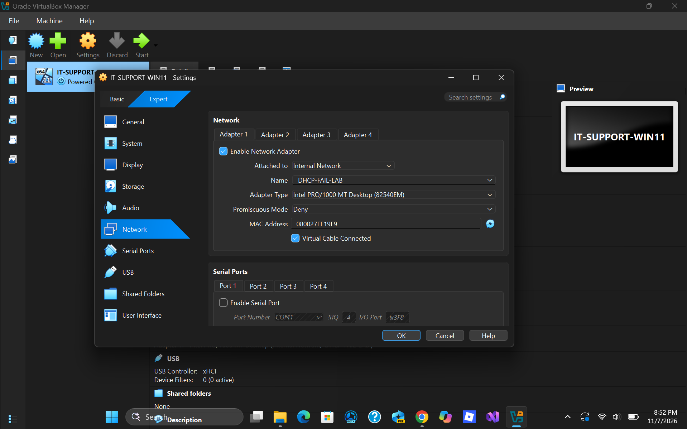
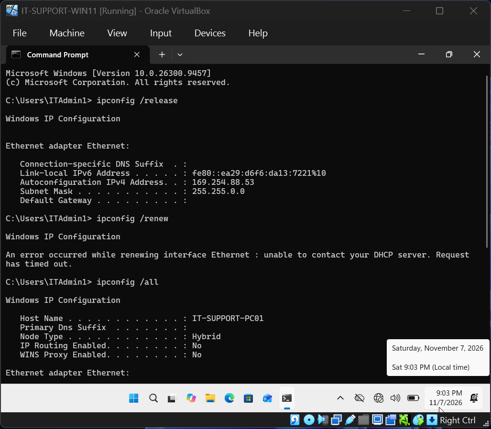
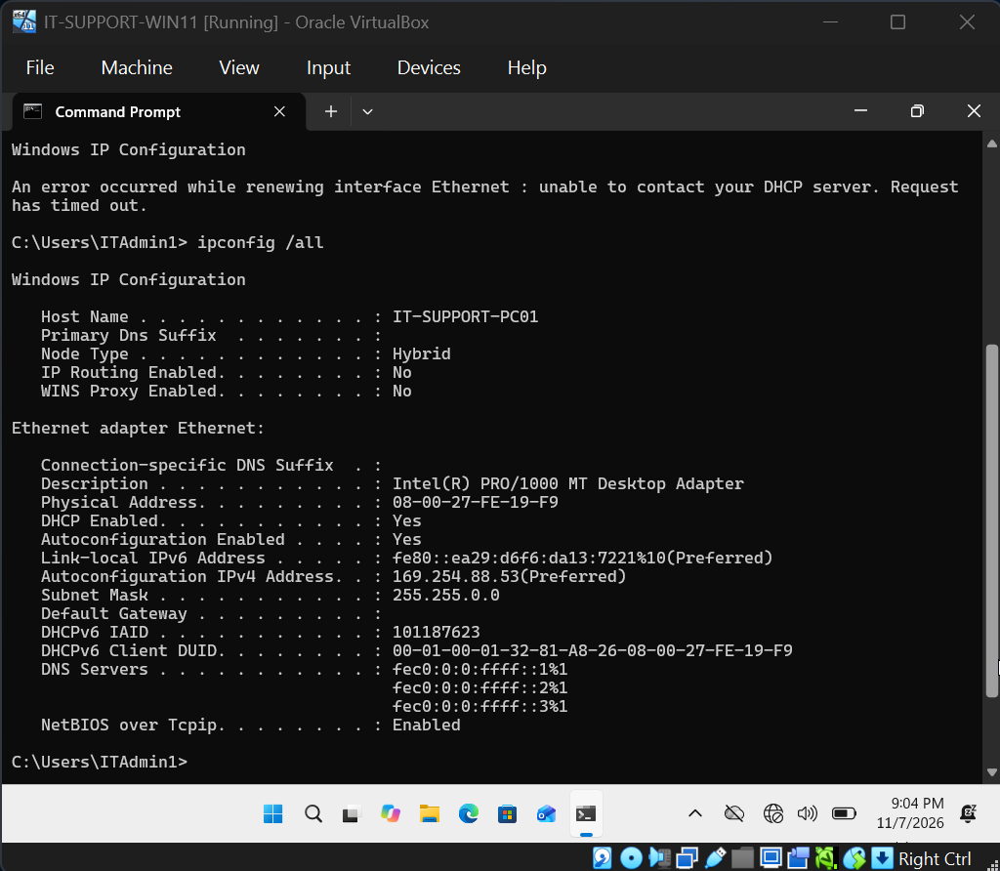
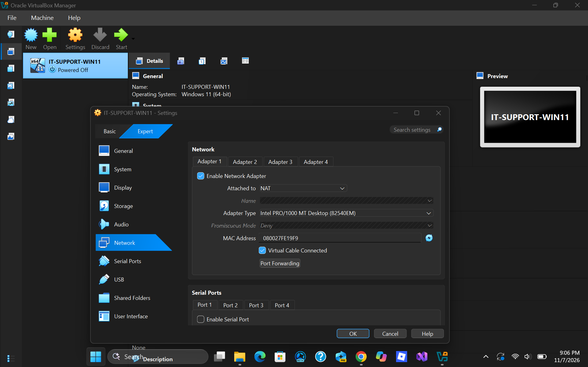
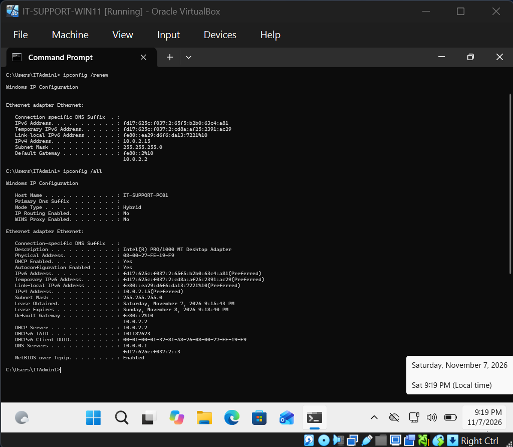
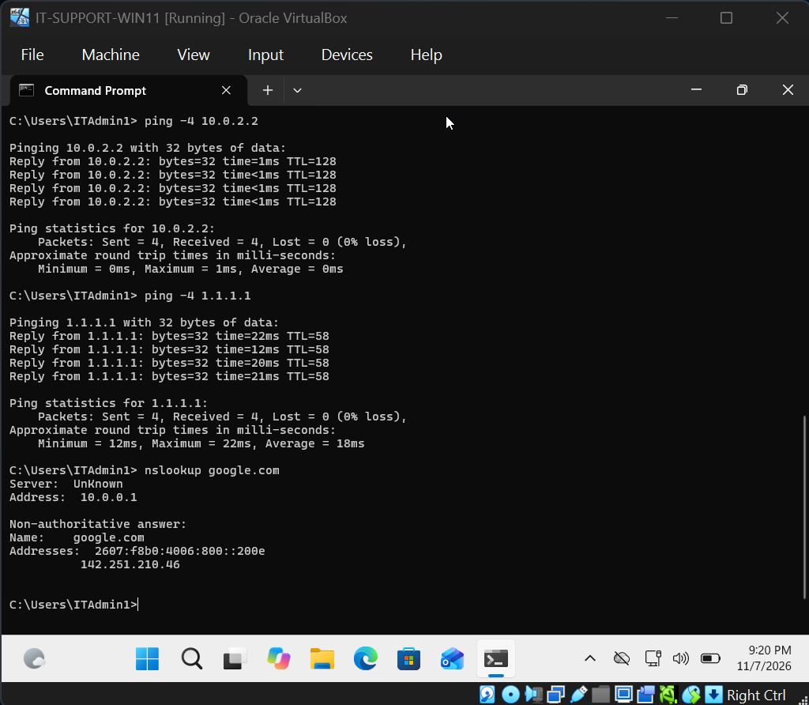

# Ticket 003 | DHCP Failure & APIPA Address Assignment

**Incident Category:** Network Troubleshooting — DHCP & IPv4 Addressing

**Environment:** Windows 11 Pro | Oracle VirtualBox

**Workstation:** `IT-SUPPORT-PC01`

**Incident Type:** Simulated IT Support Ticket

**Final Status:** Resolved and Verified

---

## 1. Incident Summary

### Problem Description

A Windows 11 workstation was placed on an isolated virtual network without an available DHCP server to simulate a common IT support incident involving failure to obtain an IPv4 address automatically.

Under normal conditions, the workstation received its IPv4 configuration from the DHCP service associated with Oracle VirtualBox NAT networking.

When the network configuration was changed to an internal network without DHCP service, Windows was unable to obtain a lease and assigned itself an Automatic Private IP Addressing (APIPA) address.

The objective was to investigate the failed DHCP renewal, identify the significance of the APIPA address and missing default gateway, restore access to the normal DHCP environment, and verify that the workstation recovered its expected network configuration.

### Resolution Summary

Diagnosed DHCP unavailability after the workstation failed to obtain an IPv4 lease and received an APIPA address of `169.254.88.53`.

The failure was reproduced by connecting the virtual machine to an isolated VirtualBox internal network named `DHCP-FAIL-LAB`.

Restored the virtual network adapter to NAT, successfully renewed the DHCP lease, and confirmed that the workstation received its expected IPv4 address, subnet mask, default gateway, and DNS server.

Follow-up connectivity and DNS tests verified successful recovery.

## 2. Technical Environment

| Component | Configuration |
|---|---|
| Operating System | Windows 11 Pro (64-bit) |
| Virtualization Platform | Oracle VirtualBox |
| Workstation Name | `IT-SUPPORT-PC01` |
| Virtual Network Adapter | Adapter 1 — Ethernet |
| Normal Network Mode | NAT |
| Failure Simulation Mode | Internal Network |
| Internal Network Name | `DHCP-FAIL-LAB` |
| Normal IPv4 Address | `10.0.2.15` |
| Normal Subnet Mask | `255.255.255.0` |
| Normal Default Gateway | `10.0.2.2` |
| Normal DNS Server | `10.0.0.1` |
| IPv4 Assignment Method | DHCP |

### Normal vs. Failed Network Configuration

| Network Parameter | Normal Configuration | Failed Configuration |
|---|---|---|
| IPv4 Address | `10.0.2.15` | `169.254.88.53` |
| Subnet Mask | `255.255.255.0` | `255.255.0.0` |
| Default Gateway | `10.0.2.2` | No IPv4 gateway assigned |
| Address Assignment | DHCP lease | APIPA |
| VirtualBox Network Mode | NAT | Internal Network |

The failure was simulated entirely within the virtual environment. The host computer's network settings were not modified.

## 3. Incident Reproduction

### Step 1 — Isolate the Workstation from DHCP

Shut down the Windows 11 virtual machine before changing its VirtualBox network configuration.

Opened:

**VirtualBox → IT-SUPPORT-WIN11 → Settings → Network → Adapter 1**

Changed the adapter's attachment mode from:

**NAT**

To:

**Internal Network**

Configured the internal network name as:

`DHCP-FAIL-LAB`

The virtual network cable remained connected.

### Technical Explanation

VirtualBox NAT networking normally provides the guest workstation with access to an automatically configured IPv4 network, including DHCP services.

Switching the adapter to the isolated internal network removed access to the normal NAT DHCP environment.

No DHCP server was configured on `DHCP-FAIL-LAB` for this exercise.

This reproduced a situation where a workstation has an active network adapter but cannot obtain a valid IPv4 lease.

### Evidence 01 — DHCP Network Isolation

**Observation:** The virtual machine was connected to the isolated internal network rather than its normal NAT environment.

## 4. Diagnostic Investigation

### Step 2 — Release the Existing DHCP Configuration

Started the Windows 11 virtual machine and opened Command Prompt.

Executed:

`ipconfig /release`

**Purpose:**

Release the workstation's existing DHCP-assigned IPv4 configuration before attempting to request a new lease.

This helped ensure that the investigation focused on whether the workstation could obtain addressing information from its current network environment.

### Step 3 — Attempt to Renew the DHCP Lease

Executed:

`ipconfig /renew`

**Purpose:**

Request IPv4 configuration from an available DHCP server.

Under normal conditions, a successful DHCP renewal provides the workstation with network settings such as an IPv4 address, subnet mask, and default gateway.

**Observed Result:**

The DHCP renewal request timed out.

The workstation was unable to obtain a new IPv4 lease from the isolated network.

### Technical Analysis

The failed renewal was consistent with the network configuration introduced during the simulation.

The virtual machine remained connected to `DHCP-FAIL-LAB`, but no DHCP server was available to respond to its request.

Because no DHCP response was received, Windows could not obtain its normal IPv4 configuration.

This result indicated a DHCP availability problem rather than an incorrectly entered static IPv4 address.

### Evidence 02 — Failed DHCP Renewal

**Diagnostic Finding:** The workstation's DHCP renewal attempt failed while connected to the isolated internal network.

### Step 4 — Inspect the Assigned IPv4 Configuration

Executed:

`ipconfig /all`

**Purpose:**

Examine the current IPv4 configuration and determine whether Windows had received a valid DHCP lease or assigned an alternative address.

**Observed Results:**

| Network Parameter | Observed Value |
|---|---|
| IPv4 Address | `169.254.88.53` |
| Subnet Mask | `255.255.0.0` |
| IPv4 Default Gateway | Not assigned |
| DHCP Lease | Not successfully obtained |
| Address Type | APIPA |

### Technical Analysis

Windows assigned an IPv4 address from the `169.254.0.0/16` range.

This range is used by Automatic Private IP Addressing (APIPA), also known as IPv4 link-local addressing.

APIPA allows a workstation to assign itself a link-local IPv4 address when it cannot obtain suitable addressing through DHCP.

The observed address, `169.254.88.53`, was not part of the workstation's expected `10.0.2.0/24` network.

The absence of an IPv4 default gateway also meant the workstation did not have a configured route for reaching destinations outside its local link.

### Why APIPA Matters

An APIPA address is a useful troubleshooting indicator because it often appears when a DHCP-enabled Windows computer cannot obtain an IPv4 lease.

However, APIPA does not automatically mean the network adapter is disabled or physically disconnected.

A computer using APIPA may still communicate with appropriately configured devices on the same local link.

In this incident, the APIPA address combined with the DHCP renewal timeout and known absence of a DHCP server identified the source of the addressing problem.

### Evidence 03 — APIPA Address Assignment

**Observation:** Windows assigned `169.254.88.53` with a `255.255.0.0` subnet mask and no IPv4 default gateway.

## 5. Root Cause Analysis

### Confirmed Root Cause

**The workstation was connected to an isolated virtual network without an available DHCP server.**

The VirtualBox adapter had been changed from NAT to the internal network `DHCP-FAIL-LAB`.

No DHCP service was configured on that internal network during the simulation.

Consequently, the workstation could not obtain a DHCP lease and fell back to APIPA addressing.

### Supporting Evidence

| Evidence | Interpretation |
|---|---|
| VirtualBox adapter attached to `DHCP-FAIL-LAB` | Workstation was isolated from its normal NAT network |
| `ipconfig /renew` timed out | DHCP lease request was unsuccessful |
| IPv4 address was `169.254.88.53` | Windows assigned an APIPA address |
| Subnet mask was `255.255.0.0` | Consistent with IPv4 link-local addressing |
| No IPv4 default gateway was assigned | Workstation lacked its normal gateway configuration |
| Restoring NAT resolved the issue | Confirmed the problem was tied to the isolated network environment |

### Root Cause Conclusion

The problem was caused by DHCP service unavailability on the network to which the workstation had been connected.

The failure did not demonstrate that a production DHCP server had crashed or that a Windows DHCP service had stopped.

Instead, the lab reproduced the symptoms of DHCP unavailability by isolating the workstation from the network that normally provided its configuration.

Because the workstation was already configured to receive an IPv4 address automatically, manually assigning a static address was unnecessary.

The appropriate corrective action was to restore access to the intended DHCP-enabled network.

## 6. Corrective Actions

### Step 5 — Restore the VirtualBox Network Connection

Shut down the Windows 11 virtual machine.

Opened:

**VirtualBox → IT-SUPPORT-WIN11 → Settings → Network → Adapter 1**

Changed the network attachment mode from:

**Internal Network**

Back to:

**NAT**

Confirmed that the virtual network adapter remained enabled and the virtual cable was connected.

Saved the configuration and restarted the virtual machine.

### Technical Explanation

Returning the adapter to NAT reconnected the workstation to its normal virtual networking environment.

This restored access to the DHCP service responsible for providing the guest workstation with its expected IPv4 address and related network configuration.

### Evidence 04 — VirtualBox NAT Networking Restored

**Corrective Action:** Reconnected the virtual workstation to its normal NAT network.

### Step 6 — Renew the DHCP Lease

After restarting Windows, opened Command Prompt.

Executed:

`ipconfig /renew`

**Purpose:**

Request a new DHCP lease from the restored network environment.

**Observed Result:**

The DHCP renewal completed successfully.

The workstation received its expected IPv4 configuration.

### Step 7 — Verify the DHCP-Assigned Network Settings

Executed:

`ipconfig /all`

**Purpose:**

Confirm that the workstation had obtained a valid DHCP lease and restored its normal network configuration.

**Observed Results:**

| Network Parameter | Restored Value |
|---|---|
| IPv4 Address | `10.0.2.15` |
| Subnet Mask | `255.255.255.0` |
| Default Gateway | `10.0.2.2` |
| DNS Server | `10.0.0.1` |
| DHCP | Enabled |

### Technical Analysis

The restored IPv4 address belonged to the expected `10.0.2.0/24` network.

The workstation also received its normal default gateway, `10.0.2.2`, and DNS server, `10.0.0.1`.

The APIPA address was no longer being used as the workstation's active IPv4 configuration.

These findings confirmed that the workstation had successfully obtained a valid DHCP lease after reconnecting to NAT.

### Evidence 05 — Successful DHCP Renewal

**Observation:** DHCP successfully provided the workstation with its expected IPv4 address, subnet mask, gateway, and DNS settings.

## 7. Resolution Verification

Receiving valid DHCP settings was the first sign of recovery. Additional tests were performed to verify that the restored network configuration was functional.

### Step 8 — Verify Default Gateway Connectivity

**Command:**

`ping -4 10.0.2.2`

**Purpose:**

Confirm that the workstation could communicate with its assigned IPv4 default gateway.

**Observed Results:**

| Metric | Result |
|---|---|
| Packets Sent | 4 |
| Packets Received | 4 |
| Packet Loss | 0% |

**Technical Analysis:**

All four ICMP Echo Requests received successful replies.

This verified that the workstation could communicate with its assigned VirtualBox NAT gateway.

### Step 9 — Verify External IPv4 Connectivity

**Command:**

`ping -4 1.1.1.1`

**Purpose:**

Verify that the workstation could communicate with an external IPv4 address after DHCP recovery.

**Observed Results:**

| Metric | Result |
|---|---|
| Packets Sent | 4 |
| Packets Received | 4 |
| Packet Loss | 0% |

**Technical Analysis:**

The workstation successfully communicated with the external destination.

This confirmed that the restored network configuration supported external IPv4 connectivity.

### Step 10 — Verify DNS Resolution

**Command:**

`nslookup google.com`

**Purpose:**

Confirm that the workstation could resolve a domain name using the DNS configuration supplied by the restored network.

**Observed Result:**

The DNS lookup succeeded and returned an IP address for `google.com`.

**Technical Analysis:**

Successful DNS resolution demonstrated that the workstation could use its restored DNS configuration.

Together with the gateway and external connectivity tests, this provided evidence that the network environment was functioning again.

### Evidence 06 — Successful Connectivity and DNS Verification

**Verification Finding:** The workstation successfully reached its default gateway, communicated with an external IPv4 destination, and resolved a domain name.

### Final Verification Results

| Verification Test | Expected Result | Actual Result | Status |
|---|---|---|---|
| VirtualBox network mode | NAT | NAT restored | Passed |
| DHCP renewal | Successful lease | Lease obtained | Passed |
| IPv4 address | `10.0.2.15` | `10.0.2.15` | Passed |
| Default gateway | `10.0.2.2` | `10.0.2.2` | Passed |
| DNS server | `10.0.0.1` | `10.0.0.1` | Passed |
| Gateway connectivity | Successful replies | 0% packet loss | Passed |
| External IPv4 connectivity | Successful replies | 0% packet loss | Passed |
| DNS resolution | Domain resolves | `google.com` resolved | Passed |

**Final Assessment:** The workstation successfully recovered from DHCP unavailability after its connection to the normal DHCP-enabled network was restored.

## 8. Technical Skills Demonstrated

### DHCP Troubleshooting

- Investigated a failed DHCP lease renewal.
- Identified the relationship between DHCP availability and automatic IPv4 configuration.
- Recognized APIPA addressing as an indicator of unsuccessful DHCP assignment.
- Verified successful DHCP recovery through a renewed lease and configuration inspection.

### IPv4 Addressing and Network Fundamentals

- Distinguished between DHCP-assigned and self-assigned IPv4 addresses.
- Identified the `169.254.0.0/16` IPv4 link-local range.
- Interpreted the significance of a missing default gateway.
- Compared failed and working network configurations.

### Virtual Network Administration

- Modified VirtualBox network adapter settings.
- Used an isolated internal network to reproduce DHCP unavailability.
- Restored NAT networking to recover the expected network environment.
- Understood how virtual network attachment affects guest connectivity and addressing.

### Command-Line Troubleshooting

- Used `ipconfig /release` to release existing DHCP configuration.
- Used `ipconfig /renew` to request a new IPv4 lease.
- Used `ipconfig /all` to inspect address assignment and gateway configuration.
- Used `ping -4` to verify gateway and external IPv4 connectivity.
- Used `nslookup` to verify DNS functionality.

### Incident Documentation

- Reproduced and recorded the incident.
- Collected command-line evidence of DHCP failure and APIPA assignment.
- Identified the root cause from the network configuration and diagnostic results.
- Documented corrective actions and verified successful recovery.

## 9. Lessons Learned

This incident demonstrated how DHCP unavailability can affect a workstation's ability to obtain the network settings needed for normal IPv4 communication.

A DHCP-enabled Windows computer may automatically assign itself an APIPA address when it cannot obtain an IPv4 lease.

Recognizing the `169.254.0.0/16` range is useful when investigating network configuration problems, but APIPA alone does not establish the exact cause of a failure.

In this case, the DHCP renewal timeout, missing default gateway, and known network isolation provided the supporting evidence needed to identify the problem.

The exercise also reinforced the importance of inspecting the underlying network environment before changing individual workstation settings.

Restoring access to the correct DHCP-enabled network resolved the issue without requiring a manually assigned static IPv4 address.

Finally, the recovery was verified through DHCP configuration inspection, default gateway testing, external IPv4 communication, and DNS resolution.

## 10. Incident Closure

| Closure Requirement | Result |
|---|---|
| Incident reproduced | Completed |
| DHCP renewal failure investigated | Completed |
| APIPA address identified | Completed |
| Missing IPv4 gateway identified | Completed |
| Root cause established | Completed |
| VirtualBox NAT networking restored | Completed |
| DHCP lease successfully renewed | Passed |
| Valid IPv4 configuration verified | Passed |
| Default gateway connectivity verified | Passed |
| External IPv4 connectivity verified | Passed |
| DNS resolution verified | Passed |
| Evidence documented | Completed |
| **Final Status** | **Resolved and Verified** |

---

**Project:** Windows & Network Troubleshooting Lab

[Return to Main Project README](../README.md)
