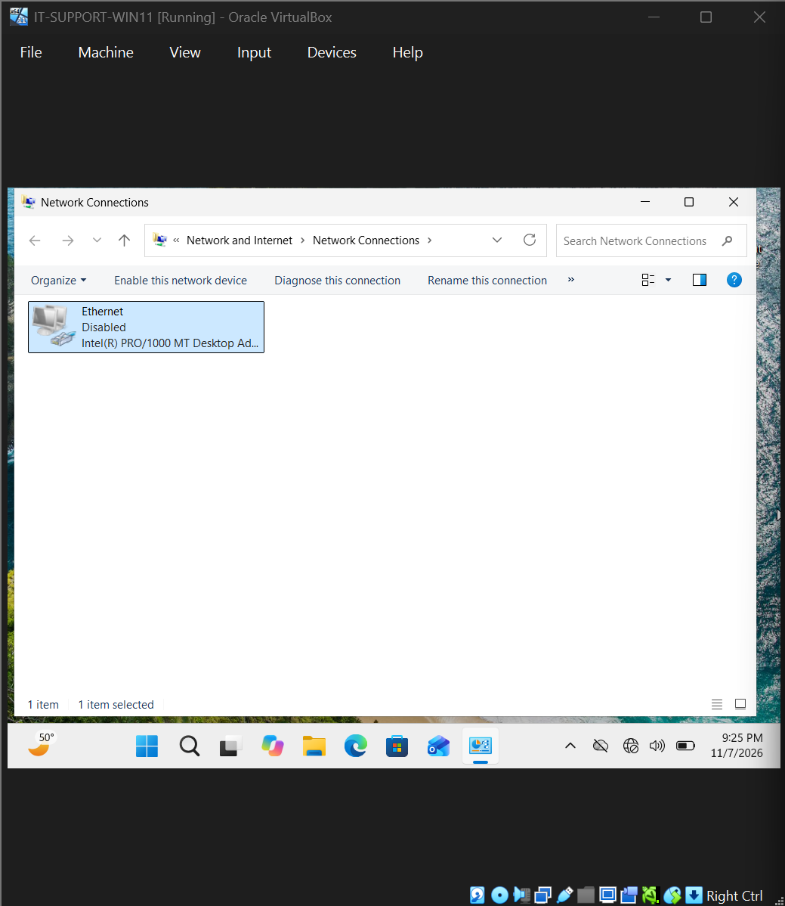
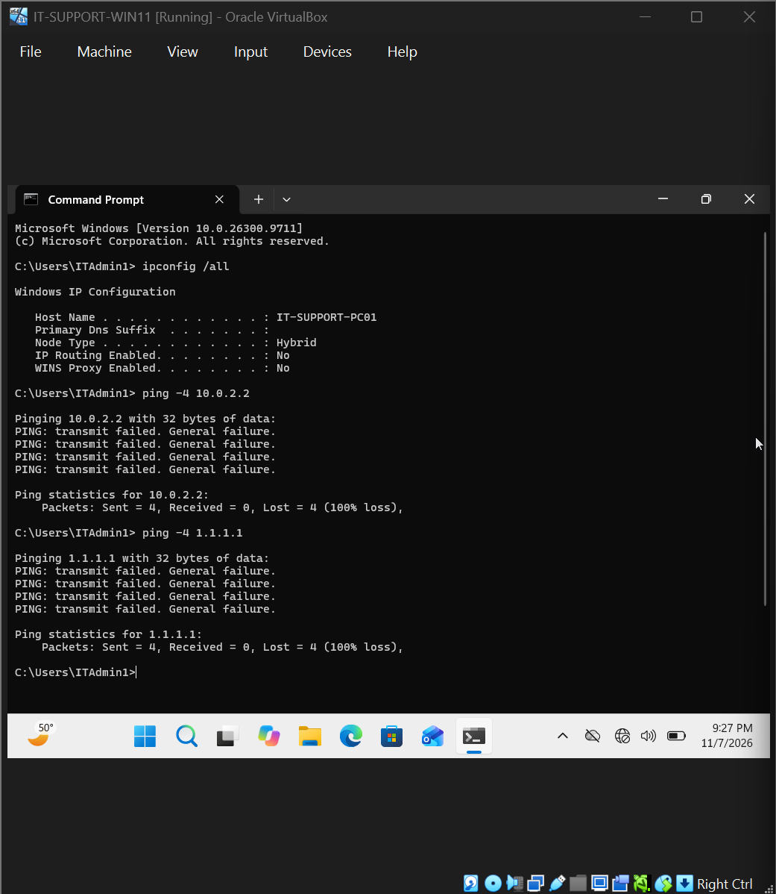
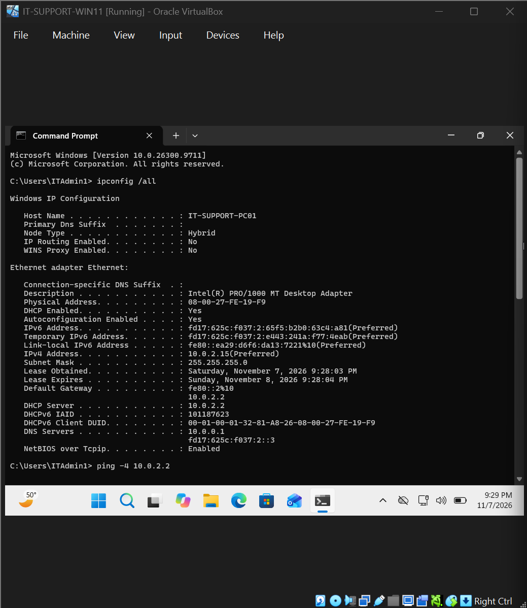
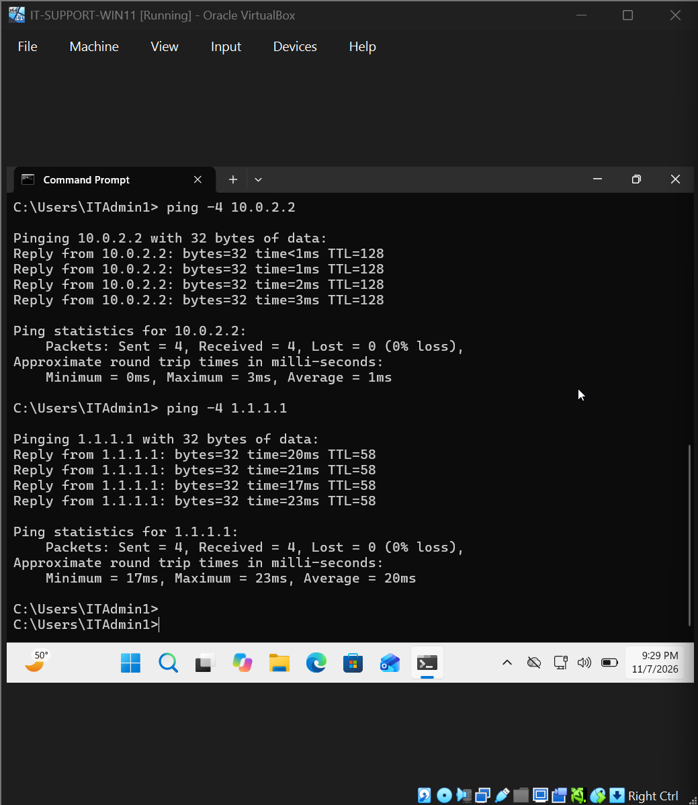

# Ticket 004 | Disabled Network Adapter & Connectivity Failure

**Incident Category:** Network Troubleshooting — Windows Network Adapter Administration

**Environment:** Windows 11 Pro | Oracle VirtualBox

**Workstation:** `IT-SUPPORT-PC01`

**Incident Type:** Simulated IT Support Ticket

**Final Status:** Resolved and Verified

---

## 1. Incident Summary

### Problem Description

A Windows 11 workstation experienced a complete loss of network connectivity after its Ethernet adapter was intentionally disabled.

This scenario simulated a common IT support incident in which a user cannot access network resources or connect to external services because the network interface has been disabled at the operating system level.

The objective was to investigate the connectivity failure, interpret the diagnostic output, identify the disabled network interface, restore network functionality, and verify successful communication with the default gateway and an external IPv4 address.

### Resolution Summary

Identified the disabled Ethernet adapter as the cause of the workstation's connectivity failure.

Network diagnostics showed that Windows could not transmit ICMP Echo Requests, returning the error **"PING: transmit failed. General failure."**

Reenabled the Ethernet adapter through Windows Network Connections, confirmed that the workstation recovered its expected DHCP-assigned IPv4 configuration, and verified successful gateway and external IPv4 communication.

Both connectivity tests completed with 0% packet loss.

## 2. Technical Environment

| Component | Configuration |
|---|---|
| Operating System | Windows 11 Pro (64-bit) |
| Virtualization Platform | Oracle VirtualBox |
| Workstation Name | `IT-SUPPORT-PC01` |
| Network Interface | Ethernet |
| VirtualBox Network Mode | NAT |
| IPv4 Assignment Method | DHCP |
| Expected IPv4 Address | `10.0.2.15` |
| Subnet Mask | `255.255.255.0` |
| Default Gateway | `10.0.2.2` |
| DNS Server | `10.0.0.1` |

### Expected vs. Failed Network State

| Network Parameter | Normal State | Failed State |
|---|---|---|
| Ethernet Adapter | Enabled | Disabled |
| IPv4 Configuration | DHCP-assigned | No active Ethernet IPv4 configuration |
| Gateway Communication | Available | Unavailable |
| External IPv4 Connectivity | Available | Unavailable |
| ICMP Echo Requests | Successfully transmitted | Local transmission failure |

The incident was reproduced inside the Windows 11 virtual machine without disabling the host computer's network connection.

## 3. Incident Reproduction

### Step 1 — Disable the Windows Ethernet Adapter

Opened the Windows Network Connections interface using:

`ncpa.cpl`

Located the **Ethernet** network adapter.

Right-clicked the adapter and selected:

**Disable**

Windows changed the adapter's status to Disabled.

### Technical Explanation

Disabling a network adapter through Windows prevents the operating system from using that interface for network communication.

Although the virtual network hardware remained configured in VirtualBox, Windows could no longer use its disabled Ethernet interface to communicate with the VirtualBox NAT network.

This differs from an incorrect DNS server or gateway configuration because the network interface itself was no longer operational.

### Evidence 01 — Ethernet Adapter Disabled

**Observation:** The Windows Ethernet adapter was disabled, preventing the workstation from using that interface for network communication.

## 4. Diagnostic Investigation

### Step 2 — Inspect Network Configuration

Opened Command Prompt and executed:

`ipconfig /all`

**Purpose:**

Inspect the workstation's network configuration and determine whether an active Ethernet interface was available with an assigned IPv4 address and default gateway.

### Observed Result

The diagnostic output no longer showed an active Ethernet configuration with the workstation's normal IPv4 settings.

The expected DHCP-assigned IPv4 address and gateway were not available through the disabled interface.

### Technical Analysis

The lack of an active Ethernet configuration was consistent with the network adapter being disabled.

This helped narrow the investigation to the network interface's operational state.

An incorrect DNS server would not, by itself, prevent the workstation from displaying an active IPv4 interface.

The investigation therefore focused on the adapter before considering changes to IP addressing or DNS.

### Step 3 — Test Default Gateway Connectivity

**Command:**

`ping -4 10.0.2.2`

**Purpose:**

Determine whether the workstation could communicate with the IPv4 gateway normally used by its VirtualBox NAT network.

The `-4` option forces the command to use IPv4.

### Observed Result

Command Prompt returned:

`PING: transmit failed. General failure.`

The test did not receive successful ICMP Echo Replies from the gateway.

### Technical Analysis

The error occurred while Windows attempted to transmit the ping request.

This is significant because it differs from a normal ping timeout.

A timeout can occur when a request is transmitted but a response is not received. A local transmission failure indicates that Windows encountered a problem sending the request.

In this case, the failure was consistent with the Ethernet adapter being disabled.

### Step 4 — Test External IPv4 Connectivity

**Command:**

`ping -4 1.1.1.1`

**Purpose:**

Determine whether the workstation could communicate with an external IPv4 address.

Using a numeric IP address avoided dependence on DNS resolution.

### Observed Results

| Test Metric | Result |
|---|---|
| Destination | `1.1.1.1` |
| Protocol | IPv4 |
| Successful Echo Replies | 0 |
| Packet Loss | 100% |
| Error | `PING: transmit failed. General failure.` |

### Technical Analysis

The external connectivity test produced the same local transmission error as the gateway test.

This supported the conclusion that the issue was occurring before successful communication with either destination.

Because both the local gateway test and external destination test failed at the transmission stage, the evidence was consistent with a local network interface problem.

Changing DNS settings would not correct the inability to transmit IPv4 packets through a disabled Ethernet adapter.

### Evidence 02 — Disabled Adapter Diagnostics

**Diagnostic Finding:** The workstation lacked an active Ethernet network configuration and could not successfully transmit IPv4 ping requests.

## 5. Root Cause Analysis

### Confirmed Root Cause

**The Windows Ethernet network adapter was disabled at the operating system level.**

The workstation's Ethernet interface had been intentionally disabled through Windows Network Connections.

As a result, the operating system could not use that interface to send or receive normal network traffic.

### Supporting Evidence

| Evidence | Interpretation |
|---|---|
| Ethernet status showed Disabled | Confirmed that the interface was administratively disabled |
| `ipconfig /all` did not show the normal active Ethernet configuration | Confirmed the expected IPv4 interface configuration was unavailable |
| Gateway ping returned `General failure` | Windows could not successfully transmit the request |
| External IPv4 ping returned `General failure` | The transmission problem affected communication with external destinations as well |
| Connectivity returned after re-enabling Ethernet | Confirmed that restoring the interface resolved the observed failure |

### Root Cause Conclusion

The evidence identified the disabled network adapter as the cause of the workstation's inability to communicate through Ethernet.

The problem was not caused by a failed DNS lookup, an incorrect static IPv4 address, or an unavailable DHCP server.

The interface itself had been disabled.

The appropriate corrective action was to reenable the Ethernet adapter and verify that Windows recovered its normal network configuration.

No manual IP address changes or VirtualBox network mode changes were needed.

## 6. Corrective Actions

### Step 5 — Reenable the Ethernet Adapter

Opened Windows Network Connections:

`ncpa.cpl`

Located the disabled Ethernet interface.

Right-clicked **Ethernet** and selected:

**Enable**

Allowed Windows to reactivate the adapter and recover its network configuration.

### Technical Explanation

Reenabling the adapter returned the Ethernet interface to an operational state.

With the interface active, Windows could again communicate with the VirtualBox NAT network and use DHCP to obtain its normal IPv4 configuration.

The corrective action addressed the confirmed cause directly without modifying unrelated network settings.

### Evidence 03 — Ethernet Adapter Restored

**Corrective Action:** Reenabled the Ethernet network interface through Windows Network Connections.

### Step 6 — Verify the Restored IPv4 Configuration

Opened Command Prompt and executed:

`ipconfig /all`

**Purpose:**

Confirm that the Ethernet interface was active and that Windows had recovered its expected network settings.

### Observed Results

| Network Parameter | Restored Value |
|---|---|
| Ethernet Adapter | Enabled |
| DHCP | Enabled |
| IPv4 Address | `10.0.2.15` |
| Subnet Mask | `255.255.255.0` |
| Default Gateway | `10.0.2.2` |
| DNS Server | `10.0.0.1` |

### Technical Analysis

The restored configuration showed that the Ethernet interface was operational again.

The workstation had recovered its normal DHCP-assigned IPv4 address and default gateway.

The address `10.0.2.15` belonged to the expected `10.0.2.0/24` VirtualBox NAT subnet.

The restored gateway, `10.0.2.2`, provided the expected network path for communication outside the workstation's local subnet.

These results confirmed recovery of the network configuration, but functional connectivity still needed to be tested.

### Evidence 04 — Restored Ethernet Network Configuration

**Observation:** The workstation recovered its expected IPv4 address, DHCP configuration, and default gateway.

## 7. Resolution Verification

### Step 7 — Verify Default Gateway Connectivity

**Command:**

`ping -4 10.0.2.2`

**Purpose:**

Confirm that the workstation could successfully communicate with its default gateway after reactivating the Ethernet interface.

### Observed Results

| Test Metric | Result |
|---|---|
| Packets Sent | 4 |
| Packets Received | 4 |
| Packets Lost | 0 |
| Packet Loss | 0% |

### Technical Analysis

All four ICMP Echo Requests received successful replies.

This demonstrated that the workstation could communicate with its default gateway after the Ethernet adapter was restored.

The earlier transmission failure was no longer occurring.

### Step 8 — Verify External IPv4 Connectivity

**Command:**

`ping -4 1.1.1.1`

**Purpose:**

Verify that the restored Ethernet interface and network configuration supported external IPv4 communication.

### Observed Results

| Test Metric | Result |
|---|---|
| Packets Sent | 4 |
| Packets Received | 4 |
| Packets Lost | 0 |
| Packet Loss | 0% |
| Average Response Time | Approximately 20 ms |

### Technical Analysis

The external connectivity test succeeded with 0% packet loss.

Compared with the earlier `General failure` messages, these successful replies demonstrated that the workstation could now transmit IPv4 packets and receive responses through the restored network connection.

The successful results established that the corrective action resolved the observed connectivity failure.

### Evidence 05 — Successful Connectivity Verification

**Verification Finding:** Both the gateway and external IPv4 connectivity tests completed successfully after the Ethernet adapter was reenabled.

### Final Verification Results

| Verification Test | Expected Result | Actual Result | Status |
|---|---|---|---|
| Ethernet adapter | Enabled | Enabled | Passed |
| DHCP | Enabled | Enabled | Passed |
| IPv4 address | `10.0.2.15` | `10.0.2.15` | Passed |
| Default gateway | `10.0.2.2` | `10.0.2.2` | Passed |
| Gateway connectivity | Successful Echo Replies | 0% packet loss | Passed |
| External IPv4 connectivity | Successful Echo Replies | 0% packet loss | Passed |
| Local ping transmission errors | No longer present | No longer observed | Passed |

**Final Assessment:** The network adapter was successfully restored, and normal IPv4 communication through the virtual Ethernet interface was verified.

## 8. Technical Skills Demonstrated

### Windows Network Administration

- Disabled and reenabled an Ethernet interface through Windows Network Connections.
- Investigated network adapter status as part of connectivity troubleshooting.
- Restored network availability without unnecessarily changing TCP/IP settings.
- Verified that Windows recovered its DHCP-assigned configuration.

### Network Troubleshooting

- Distinguished an administratively disabled adapter from an incorrect IP configuration.
- Investigated gateway and external IPv4 connectivity failures.
- Identified a local ping transmission failure.
- Compared diagnostic results before and after correcting the issue.

### Command-Line Diagnostics

- Used `ipconfig /all` to inspect active network configuration.
- Used `ping -4` to test gateway connectivity.
- Used `ping -4` to test external IPv4 communication.
- Interpreted the error `PING: transmit failed. General failure.`
- Verified network recovery through repeatable diagnostic tests.

### Incident Documentation

- Recorded the simulated adapter failure.
- Collected command-line evidence of the network outage.
- Identified the root cause using adapter status and diagnostic results.
- Documented the corrective action.
- Verified the restored network configuration and connectivity.

## 9. Lessons Learned

This scenario demonstrated how a disabled network adapter can produce a complete loss of network connectivity even when the underlying virtual network remains correctly configured.

The incident reinforced the importance of checking the operational state of a network interface early in the troubleshooting process.

It also demonstrated why the exact wording of diagnostic errors matters.

The message `PING: transmit failed. General failure.` indicates that the request could not be successfully transmitted by the local system. This differs from receiving no reply after a request has been sent.

Recognizing that distinction helped isolate the incident to the local workstation instead of assuming that the external destination was unavailable.

The corrective action was straightforward once the root cause was identified: reenable the Ethernet adapter.

However, the resolution was not considered verified until the workstation recovered its expected IPv4 configuration and successfully communicated with both its default gateway and an external IPv4 address.

## 10. Incident Closure

| Closure Requirement | Result |
|---|---|
| Incident reproduced | Completed |
| Disabled Ethernet interface identified | Completed |
| IPv4 configuration investigated | Completed |
| Gateway transmission failure documented | Completed |
| External connectivity failure documented | Completed |
| Root cause established | Completed |
| Ethernet adapter reenabled | Completed |
| DHCP configuration restored | Passed |
| Gateway connectivity verified | Passed |
| External IPv4 connectivity verified | Passed |
| Evidence documented | Completed |
| **Final Status** | **Resolved and Verified** |

---

**Project:** Windows & Network Troubleshooting Lab

[Return to Main Project README](../README.md)
