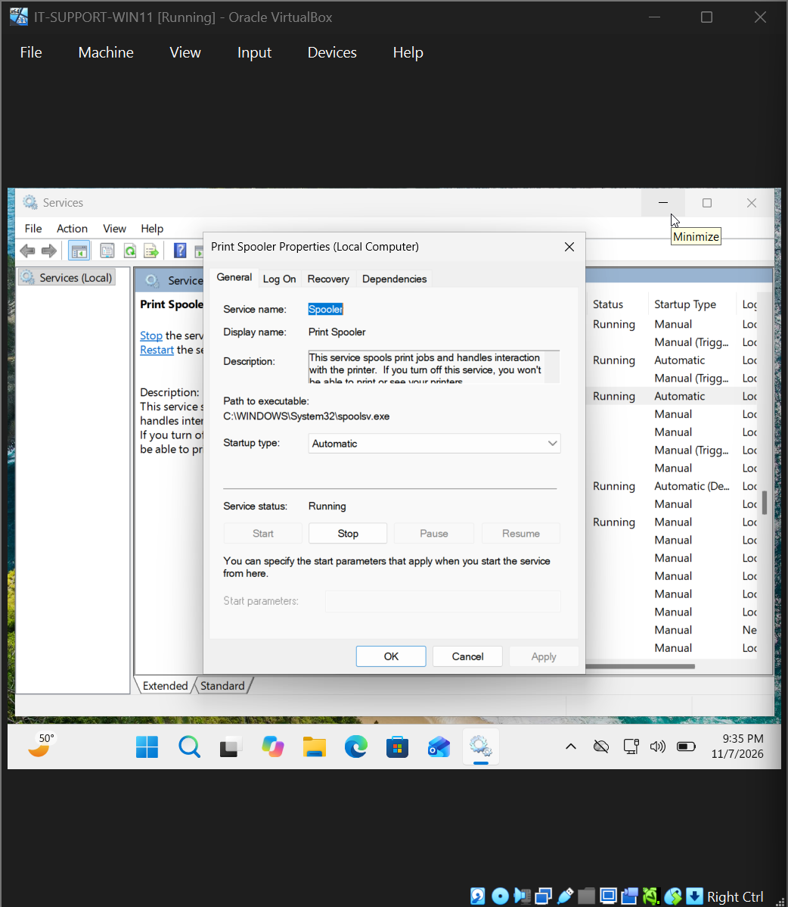
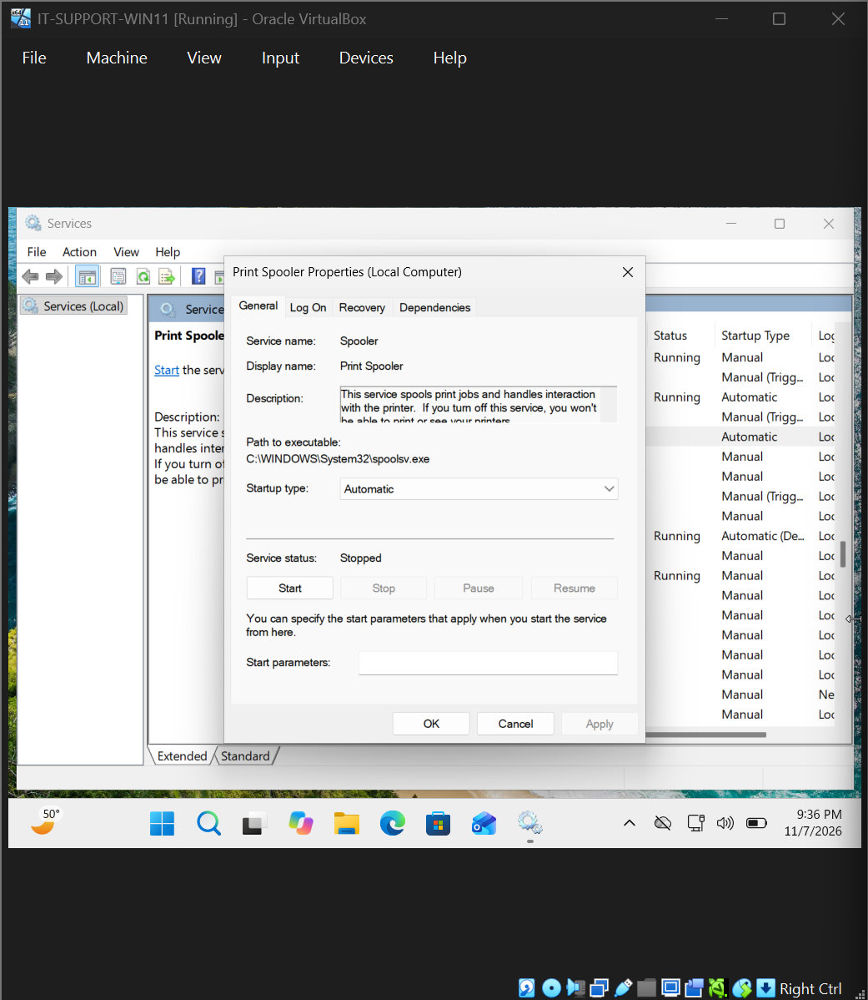
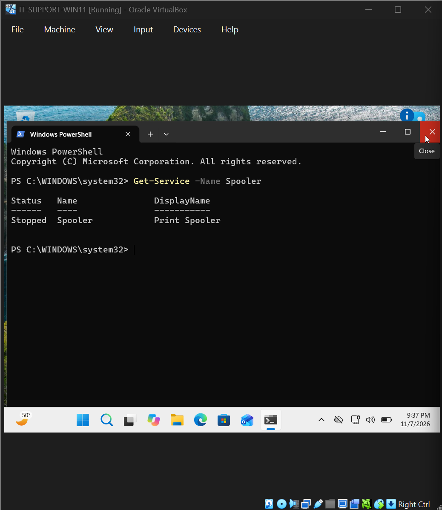
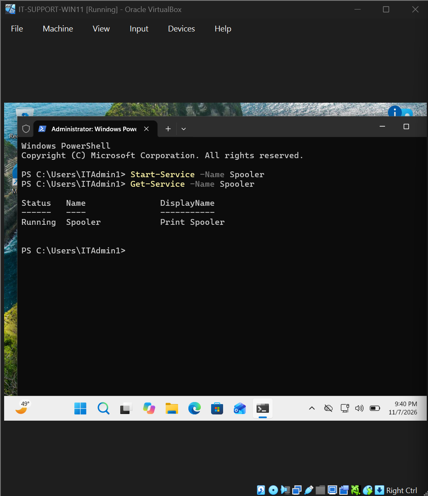
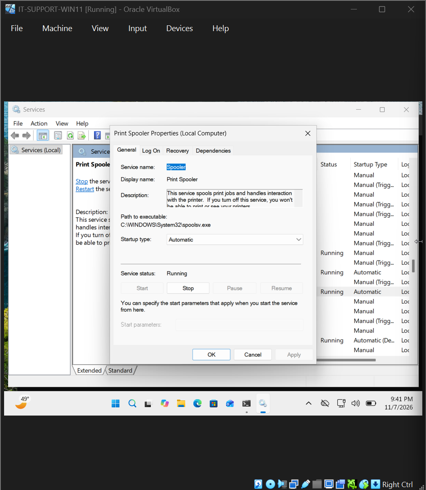

# Ticket 005 | Windows Print Spooler Service Failure

**Incident Category:** Windows Administration — Service Troubleshooting

**Environment:** Windows 11 Pro | Oracle VirtualBox

**Workstation:** `IT-SUPPORT-PC01`

**Incident Type:** Simulated IT Support Ticket

**Final Status:** Resolved — Service Recovery Verified

---

## 1. Incident Summary

Simulated a Windows printing-service incident by stopping the Print Spooler and verifying its state using both the Services console and PowerShell.

### Incident at a Glance

| Item | Finding |
|---|---|
| Reported issue | Windows Print Spooler service was stopped |
| Diagnostic evidence | `Get-Service -Name Spooler` returned `Stopped`; the Services console showed the same service state |
| Root cause | The service had been intentionally stopped; its startup type remained `Automatic` |
| Tools used | `services.msc`, `Get-Service`, `Start-Service` |
| Corrective action | Restarted the service with `Start-Service -Name Spooler` |
| Verified result | PowerShell and Windows Services both showed `Running` afterward; startup type remained `Automatic` |

**Testing scope:** Service recovery was verified. No printer was installed, so end-to-end document printing was not tested.

## 2. Technical Environment

| Component | Configuration |
|---|---|
| Operating System | Windows 11 Pro (64-bit) |
| Virtualization Platform | Oracle VirtualBox |
| Workstation Name | `IT-SUPPORT-PC01` |
| Administrative Interface | Windows Services (`services.msc`) |
| Command-Line Tool | Windows PowerShell |
| Service Display Name | Print Spooler |
| Service Name | `Spooler` |
| Startup Type | Automatic |
| Initial Service Status | Running |
| Simulated Failure State | Stopped |
| Restored Service Status | Running |

### Service State Comparison

| Parameter | Normal State | Simulated Failure | Restored State |
|---|---|---|---|
| Print Spooler | Running | Stopped | Running |
| Startup Type | Automatic | Automatic | Automatic |
| Service Availability | Available | Unavailable | Available |
| Printing Verification | Not tested | Not tested | Not tested |

The incident was reproduced entirely within the Windows 11 virtual machine.

## 3. Initial Service Inspection

### Step 1 — Open Windows Services

Opened the Windows Services management console using:

`services.msc`

Located the service named:

**Print Spooler**

Reviewed its operational status and startup configuration.

### Observed Results

| Service Property | Observed Value |
|---|---|
| Display Name | Print Spooler |
| Service Name | Spooler |
| Status | Running |
| Startup Type | Automatic |

### Technical Analysis

The initial inspection confirmed that the Print Spooler service was running before the failure was introduced.

Its startup type was configured as Automatic, meaning Windows was configured to start the service automatically during system startup.

A service's startup type and current operational status represent different properties.

A service configured for Automatic startup can still be stopped manually or become unavailable because of a service failure.

Establishing the initial service state provided a reference point for comparing the simulated failure and subsequent recovery.

### Evidence 01 — Initial Print Spooler Status

**Observation:** The Print Spooler service was initially running with Automatic startup configured.

## 4. Incident Reproduction

### Step 2 — Stop the Print Spooler Service

Within the Windows Services management console, selected:

**Print Spooler**

Used the available service controls to stop the service.

After the operation completed, Windows Services showed that the Print Spooler was no longer running.

### Technical Explanation

Stopping the Print Spooler interrupts the Windows service responsible for managing print jobs.

This can produce symptoms similar to a real support incident in which users report that documents remain in a print queue or printing is unavailable.

The service remained configured with an Automatic startup type; only its current running state was changed.

No printer or production printing environment was involved in this simulation.

### Evidence 02 — Print Spooler Stopped

**Observation:** The Print Spooler service had been stopped while its Automatic startup configuration remained unchanged.

## 5. Diagnostic Investigation

### Step 3 — Verify the Service Status with PowerShell

Opened Windows PowerShell and executed:

`Get-Service -Name Spooler`

**Purpose:**

Query the Print Spooler's current service status using its Windows service name.

This provided command-line confirmation of the service failure independently of the graphical Services console.

### Observed Result

PowerShell returned the Print Spooler service with a status of:

**Stopped**

### Technical Analysis

The diagnostic output confirmed that Windows recognized the service but that it was not currently running.

This distinction is useful during Windows troubleshooting.

A service may exist on a workstation and be configured for automatic startup without being operational at the time of investigation.

The command provided direct evidence of the service state, supporting the initial observation from Windows Services.

### Evidence 03 — PowerShell Service Diagnostics

**Diagnostic Finding:** PowerShell confirmed that the `Spooler` service was stopped.

## 6. Root Cause Analysis

### Confirmed Root Cause

**The Windows Print Spooler service was intentionally stopped.**

The incident was reproduced by manually stopping the service through the Windows Services console.

This changed its operational state from Running to Stopped.

The service's Automatic startup configuration was not changed.

### Supporting Evidence

| Evidence | Interpretation |
|---|---|
| Initial Windows Services inspection showed Running | Established that the service was operational before the simulation |
| Service was manually stopped | Identified the direct action that introduced the failure |
| Windows Services showed the service was stopped | Confirmed the simulated failure in the graphical interface |
| `Get-Service -Name Spooler` returned Stopped | Independently confirmed the service's operational state |
| Service returned to Running after the corrective action | Verified successful service recovery |

### Root Cause Conclusion

The immediate cause of the simulated incident was the Print Spooler service being stopped.

The evidence did not indicate that the service executable was missing, that its startup configuration was disabled, or that a printer driver had failed.

Therefore, reinstalling drivers, changing printer configurations, or modifying service startup settings was unnecessary for this exercise.

The appropriate corrective action was to restart the stopped service and confirm its operational status.

**Investigation Scope:** This lab intentionally stopped the service. It did not investigate an unexpected service crash, a failed print driver, or an actual user-reported printing incident.

## 7. Corrective Actions

### Step 4 — Restart the Print Spooler Service

Opened PowerShell with administrative privileges.

Executed:

`Start-Service -Name Spooler`

**Purpose:**

Send a start request to the Windows Service Control Manager for the Print Spooler service.

The command uses the internal Windows service name, `Spooler`, rather than the display name shown in the Services console.

### Technical Explanation

PowerShell provides a command-line method for administering Windows services.

The `Start-Service` cmdlet requests that a stopped service enter the Running state.

Using PowerShell is useful in IT support environments because service administration can be performed without navigating through the graphical management console.

However, executing a service-start command does not, by itself, establish that the service is running successfully.

A follow-up status check is needed to verify the result.

### Step 5 — Confirm the Service Restarted

Executed:

`Get-Service -Name Spooler`

**Observed Result:**

The service status changed to:

**Running**

### Technical Analysis

The follow-up query confirmed that Windows had successfully started the Print Spooler service.

The difference between the earlier Stopped status and the new Running status provided evidence that the corrective action was successful.

### Evidence 04 — Print Spooler Restarted

**Corrective Action:** Restarted the stopped Print Spooler service using PowerShell and confirmed that it returned to Running.

## 8. Resolution Verification

### Step 6 — Verify the Service Using Windows Services

Returned to the Windows Services management console:

`services.msc`

Located the Print Spooler service and inspected its properties.

### Observed Results

| Service Property | Expected Result | Observed Result |
|---|---|---|
| Display Name | Print Spooler | Print Spooler |
| Service Name | Spooler | Spooler |
| Service Status | Running | Running |
| Startup Type | Automatic | Automatic |

### Technical Analysis

The Windows Services console confirmed that the Print Spooler was running after the corrective action.

The startup type remained Automatic, indicating that the service's normal startup configuration had been preserved.

The PowerShell status check and final graphical verification provided two ways to confirm the restored service state.

### Evidence 05 — Final Service Verification

**Verification Finding:** The Print Spooler service was running, and its Automatic startup configuration remained intact.

### Final Verification Results

| Verification Test | Expected Result | Actual Result | Status |
|---|---|---|---|
| Service exists | Print Spooler present | Present | Passed |
| Service status after failure | Stopped | Stopped | Confirmed |
| PowerShell restart | Start request succeeds | Service started | Passed |
| PowerShell status verification | Running | Running | Passed |
| Windows Services verification | Running | Running | Passed |
| Startup configuration | Automatic | Automatic | Passed |
| Physical printing test | Outside lab scope | Not performed | Not Tested |

### Verification Limitations

No physical or virtual printer was installed for an end-to-end printing test.

As a result, this exercise confirmed recovery of the Windows Print Spooler service but did not establish that a document could be printed successfully.

A production incident would normally require additional verification, such as submitting a test print job, examining the print queue, and confirming that the intended printer received the document.

**Final Assessment:** The simulated Windows service failure was successfully resolved, and the restored service state was verified using PowerShell and Windows Services.

## 9. Technical Skills Demonstrated

### Windows Service Administration

- Inspected Windows service status and startup configuration.
- Located and administered the Print Spooler through `services.msc`.
- Distinguished between a service's startup type and its current running state.
- Restored a stopped Windows background service.

### PowerShell Administration

- Used `Get-Service` to investigate service availability.
- Used `Start-Service` to restart a stopped service.
- Verified the results of an administrative action through a follow-up command.
- Used Windows service names to target specific services.

### Troubleshooting and Root-Cause Analysis

- Established the normal operating state before reproducing a failure.
- Confirmed the stopped service using graphical and command-line tools.
- Identified the direct cause of the simulated incident.
- Selected a targeted corrective action without changing unrelated configurations.

### Technical Documentation

- Recorded the initial service state.
- Documented the failure and diagnostic findings.
- Captured evidence of corrective actions and final verification.
- Distinguished verified service recovery from printing functionality that was not tested.

## 10. Lessons Learned

This incident demonstrated how a stopped Windows service can affect system functionality even when the service remains installed and configured for automatic startup.

The exercise reinforced the importance of checking a service's current operational status before attempting more disruptive troubleshooting actions.

The combination of Windows Services and PowerShell provided two useful methods for investigating and administering the same service.

It also demonstrated why technical verification must match the action performed.

Restarting the Print Spooler and confirming a Running status establishes successful service recovery, but it does not independently confirm that a printer, driver, or print queue is functioning correctly.

In a real support environment, the next step would be to test the affected printing workflow and confirm that the original user-reported symptom had been resolved.

## 11. Incident Closure

| Closure Requirement | Result |
|---|---|
| Initial service status documented | Completed |
| Service failure reproduced | Completed |
| Stopped service confirmed in Windows Services | Completed |
| Stopped service confirmed using PowerShell | Completed |
| Root cause established | Completed |
| Print Spooler restarted using PowerShell | Completed |
| Running status verified using PowerShell | Passed |
| Running status verified in Windows Services | Passed |
| Automatic startup configuration confirmed | Passed |
| End-to-end printing tested | Not Performed |
| Evidence documented | Completed |
| **Final Status** | **Service Restored and Verified** |

---

**Project:** Windows & Network Troubleshooting Lab

[Return to Main Project README](../README.md)
