# Ticket 006 | NTFS File & Folder Permissions Troubleshooting

**Incident Category:** Windows Administration — User Access Control & NTFS Permissions

**Environment:** Windows 11 Pro | Oracle VirtualBox

**Workstation:** `IT-SUPPORT-PC01`

**Incident Type:** Simulated IT Support Ticket

**Final Status:** Resolved and Verified

---

## 1. Incident Summary

### Problem Description

A Windows 11 workstation was configured to simulate an IT support incident in which a standard employee account could not access a shared folder containing an internal company document.

The scenario involved creating a standard user account, examining existing NTFS permissions, deliberately restricting folder access, reproducing an access-denied error, and restoring appropriate permissions.

The objective was to provide the employee with sufficient access to open and read the document without allowing unauthorized modifications.

During the investigation, additional problems were encountered while adjusting permissions through Windows Security and referencing the test document from Command Prompt.

These issues required further troubleshooting using `icacls`, file path verification, and permission testing under the affected user account.

### Resolution Summary

Created a standard Windows account named `LabEmployee` and a test folder at:

`C:\IT-Support-Lab\SharedDocuments`

Restricted NTFS permissions to reproduce an access-denied condition.

After Windows Security encountered an error while applying permissions, used the `icacls` command-line utility to modify access rights.

Verified that `LabEmployee` could open and read the test document while an attempt to append content returned **Access is denied**.

The final configuration preserved administrative access while limiting the standard account to read and execute permissions.

## 2. Technical Environment

| Component | Configuration |
|---|---|
| Operating System | Windows 11 Pro (64-bit) |
| Virtualization Platform | Oracle VirtualBox |
| Workstation | `IT-SUPPORT-PC01` |
| Administrative Account | `ITAdmin1` |
| Standard User Account | `LabEmployee` |
| Test Directory | `C:\IT-Support-Lab\SharedDocuments` |
| Test File | `Company-Report.txt.txt` |
| File System | NTFS |
| Administrative Tools | Windows Security, Command Prompt, `icacls` |
| Intended Employee Access | Read & Execute |
| Administrative Access | Full Control |

### Intended Access Policy

| Account or Group | Intended Permission |
|---|---|
| Administrators | Full Control |
| SYSTEM | Full Control |
| LabEmployee | Read & Execute |
| Other Standard Users | No access through the removed broad user-group entries |

The purpose was to demonstrate a least-privilege access configuration in which a standard employee could view an authorized document but could not modify it.

## 3. Test Environment Preparation

### Step 1 — Create a Standard Employee Account

Created a local Windows user account:

`LabEmployee`

Configured the account as a Standard User rather than an administrator.

### Technical Explanation

Windows accounts can have different levels of administrative privilege.

Standard accounts are appropriate for testing access restrictions because they do not automatically receive the elevated privileges available to local administrators.

Using a separate employee account allowed file permissions to be tested from the perspective of the affected user instead of relying only on the administrator's view of the configuration.

### Evidence 01 — Standard Employee Account

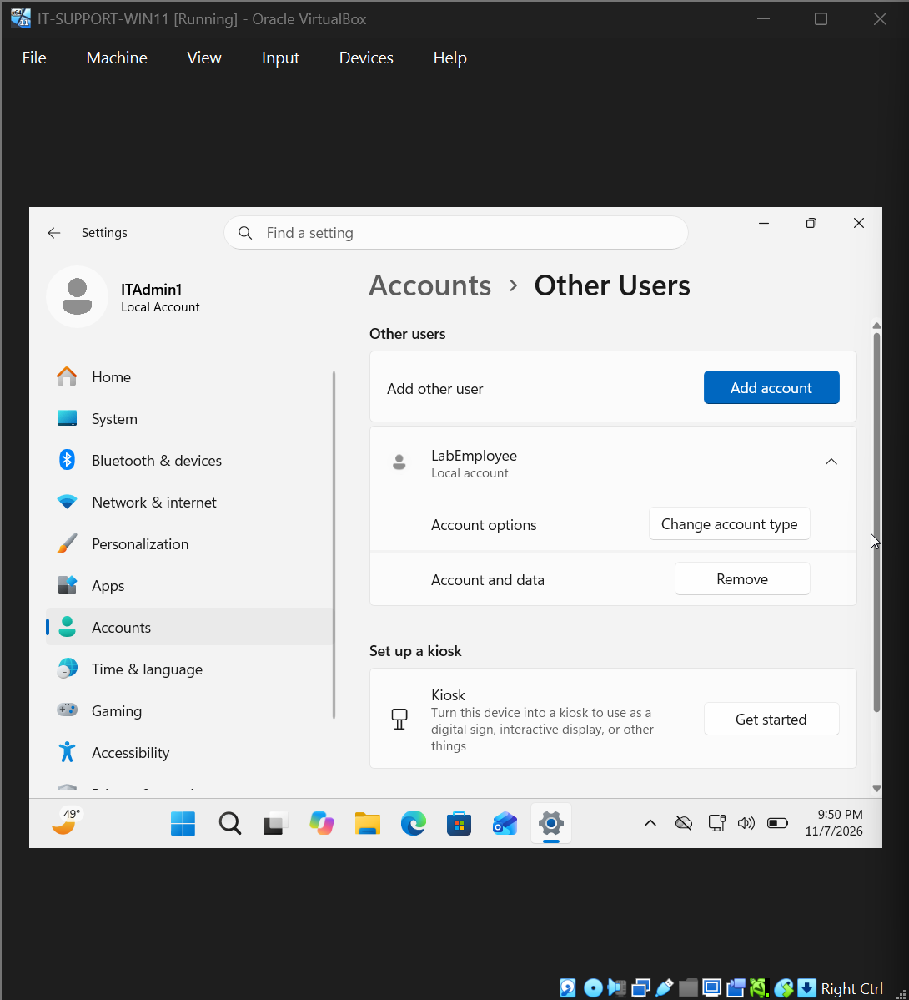

**Observation:** The `LabEmployee` account was available for testing standard-user access to protected resources.

### Step 2 — Create the Test Directory

Created the following directory structure:

`C:\IT-Support-Lab\SharedDocuments`

The `SharedDocuments` folder represented a location used to store internal company documents.

### Evidence 02 — Test Folder Created

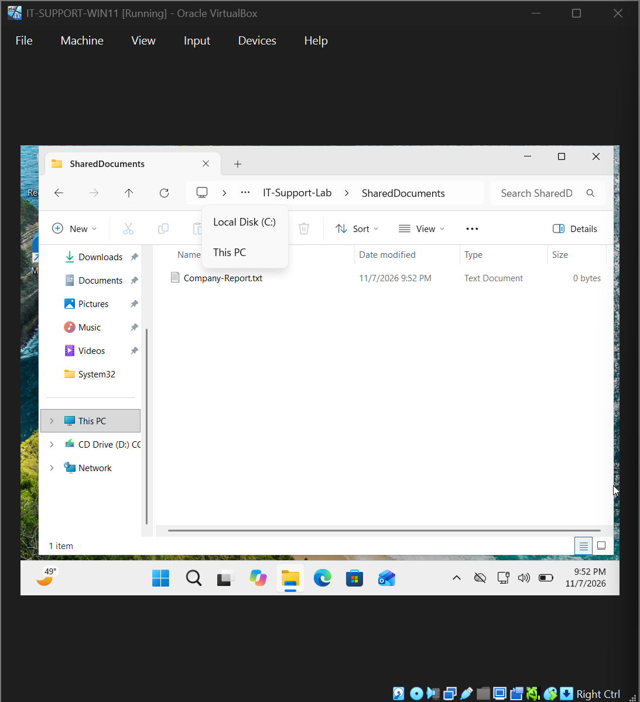

**Observation:** The test directory was created and available for NTFS permission configuration.

### Step 3 — Create a Test Document

Created a text document containing sample internal company information.

The document included:

- IT Support Lab — Test Document
- Department: Administration
- Purpose: File permissions troubleshooting
- Classification: Internal Test Document

The actual filename was:

`Company-Report.txt.txt`

The repeated `.txt` extension became relevant during later command-line troubleshooting.

### Evidence 03 — Test Document Created

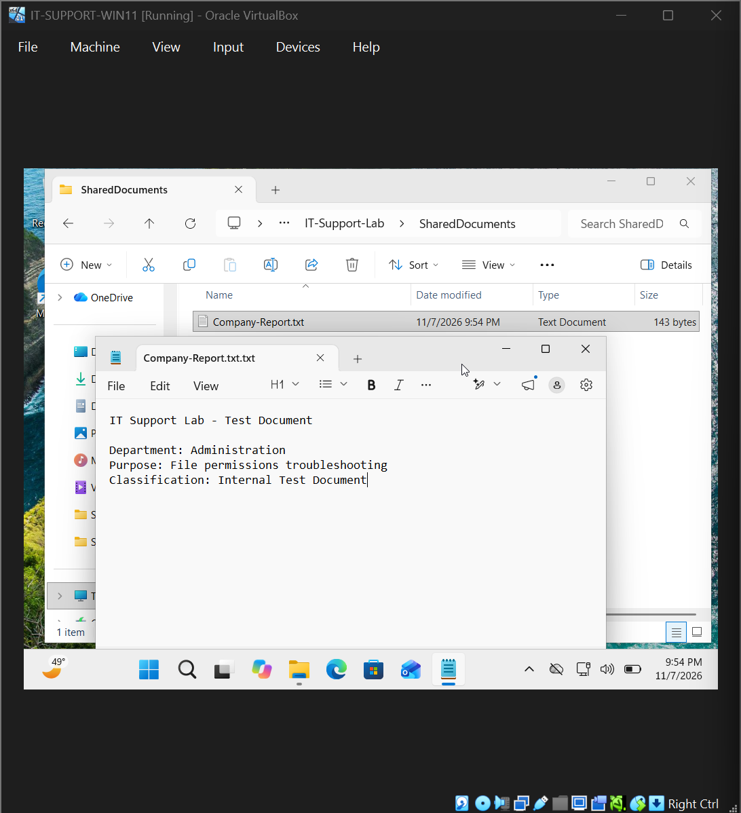

**Observation:** The test document was created to provide a resource for verifying read and write permissions.

## 4. Initial NTFS Permissions Investigation

### Step 4 — Inspect Existing Folder Permissions

Opened the `SharedDocuments` folder's properties and navigated to:

**Properties → Security → Advanced**

Reviewed the existing NTFS access control entries.

### Observed Permissions

| Security Principal | Initial Permission |
|---|---|
| Administrators | Full Control |
| SYSTEM | Full Control |
| Users | Read & Execute |
| Authenticated Users | Modify |

The folder initially contained permissions inherited from its parent directory.

### Technical Analysis

NTFS uses Access Control Lists (ACLs) to define which security principals may access files and folders.

An Access Control Entry (ACE) specifies the permissions associated with a particular user or group.

The original folder configuration included broad access entries for standard users and authenticated users.

The `Authenticated Users` Modify permission was more permissive than the intended read-only access policy for this exercise.

To reproduce a restricted-access incident, the broad group permissions needed to be removed while preserving appropriate administrative access.

### Evidence 04 — Original NTFS Permissions

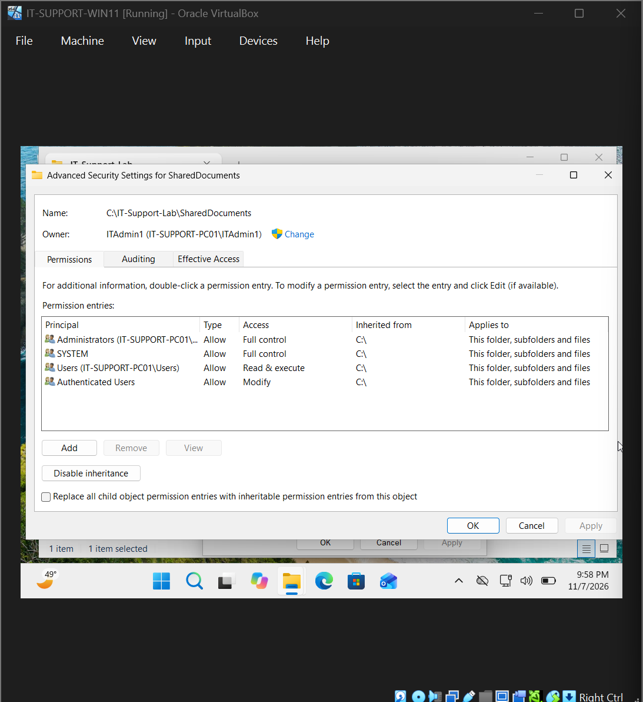

**Observation:** The folder initially contained inherited access entries that allowed broader user access than intended for the simulation.

## 5. Incident Reproduction

### Step 5 — Restrict Folder Access

Opened the folder's Advanced Security Settings.

Disabled permission inheritance and selected the option to convert inherited permissions into explicit permissions.

Removed the broad access entries for:

- Users
- Authenticated Users

Retained Full Control for:

- Administrators
- SYSTEM

### Technical Explanation

Disabling inheritance prevents the folder from continuing to receive inherited permission entries from its parent.

Converting inherited entries into explicit entries allowed the existing permissions to be reviewed and modified individually.

Removing the broad user-group entries restricted access to the folder while preserving administrative and system-level permissions.

### Evidence 05 — Restricted Folder Permissions

**Observation:** The folder's permissions were restricted to reproduce an access-control failure for the standard employee account.

### Step 6 — Reproduce the Access-Denied Error

Signed in to Windows using:

`LabEmployee`

Attempted to open:

`C:\IT-Support-Lab\SharedDocuments`

### Observed Result

Windows displayed the message:

**"You don't currently have permission to access this folder."**

The employee account could not access the protected directory using its existing permissions.

### Technical Analysis

The access-denied message confirmed that the standard account did not have sufficient access to the folder.

The result was consistent with the removal of the broad group permissions.

The test was performed without elevating the employee account to administrator privileges.

This was important because the objective was to restore access for the standard user under an appropriate permission policy.

### Evidence 06 — Employee Access Denied

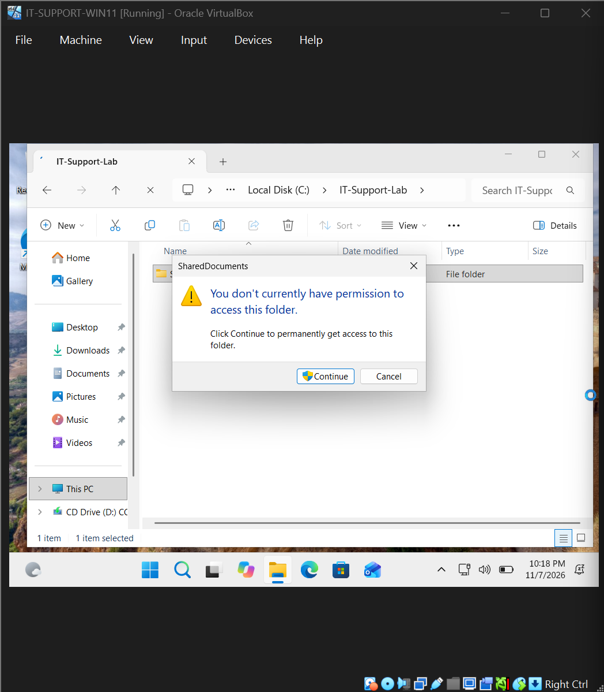

**Diagnostic Finding:** The standard employee account was unable to access the folder because sufficient NTFS permissions had not been granted.

## 6. Root Cause Analysis

### Confirmed Root Cause

**The standard employee account lacked sufficient NTFS permissions to access the restricted folder.**

The original broad group entries were removed as part of the simulation.

After those permissions were removed, `LabEmployee` had no suitable access entry granting the required folder permissions.

### Supporting Evidence

| Evidence | Interpretation |
|---|---|
| Original ACL contained broader user-group permissions | Established the initial access configuration |
| Broad group permissions were removed | Identified the action that introduced the restriction |
| Administrators and SYSTEM retained Full Control | Administrative access was preserved |
| `LabEmployee` received an access-denied message | Confirmed insufficient permissions for the standard account |
| Access succeeded after appropriate permissions were granted | Supported the NTFS access-control diagnosis |

### Root Cause Conclusion

The access failure was caused by the folder's restrictive NTFS permissions.

The issue was unrelated to network connectivity, DNS, DHCP, or Windows account authentication.

The appropriate solution was to grant the affected employee account only the permissions required for the intended task.

Because the employee needed to read the document but not modify it, **Read & Execute** was selected instead of Modify or Full Control.

## 7. Corrective Actions and Additional Troubleshooting

### Step 7 — Attempt Permission Changes Through Windows Security

Returned to the folder's advanced security settings and attempted to grant `LabEmployee` the required access.

During this process, Windows displayed the error:

**"Failed to enumerate objects in the container. Access is denied."**

### Technical Analysis

The error indicated that Windows encountered a problem while processing the permission operation.

The message alone did not establish the exact underlying cause.

Rather than assuming the graphical operation had succeeded, further troubleshooting was performed using the Windows command-line permission management utility.

### Evidence 07 — Windows Security Permission Error

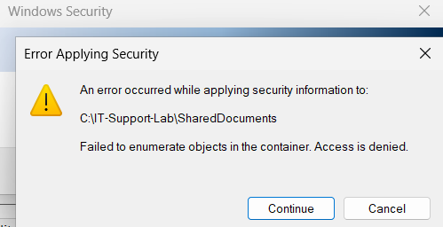

**Observation:** An error occurred during the graphical permission-management process, requiring additional investigation.

### Step 8 — Use ICACLS to Grant Read Access

Opened Command Prompt with administrative privileges.

Executed:

`icacls "C:\IT-Support-Lab\SharedDocuments" /grant "LabEmployee:(RX)"`

### Purpose

Use the Windows `icacls` utility to grant Read & Execute permissions to the standard employee account on the specified folder.

### Command Breakdown

| Command Component | Purpose |
|---|---|
| `icacls` | Display or modify NTFS access control lists |
| `"C:\IT-Support-Lab\SharedDocuments"` | Target folder |
| `/grant` | Add or update an access permission entry |
| `LabEmployee` | Account receiving the permission |
| `(RX)` | Read & Execute permission |

### Observed Result

The command completed successfully and reported that the targeted folder had been processed.

### Technical Analysis

The successful result confirmed that the command-line permission modification was accepted for the folder.

However, a successful permission command is not sufficient evidence that every file inside the directory has the intended access permissions.

File and folder ACLs must be inspected separately when necessary, and the affected user's ability to perform the intended action should be tested directly.

### Evidence 08 — ICACLS Permission Command

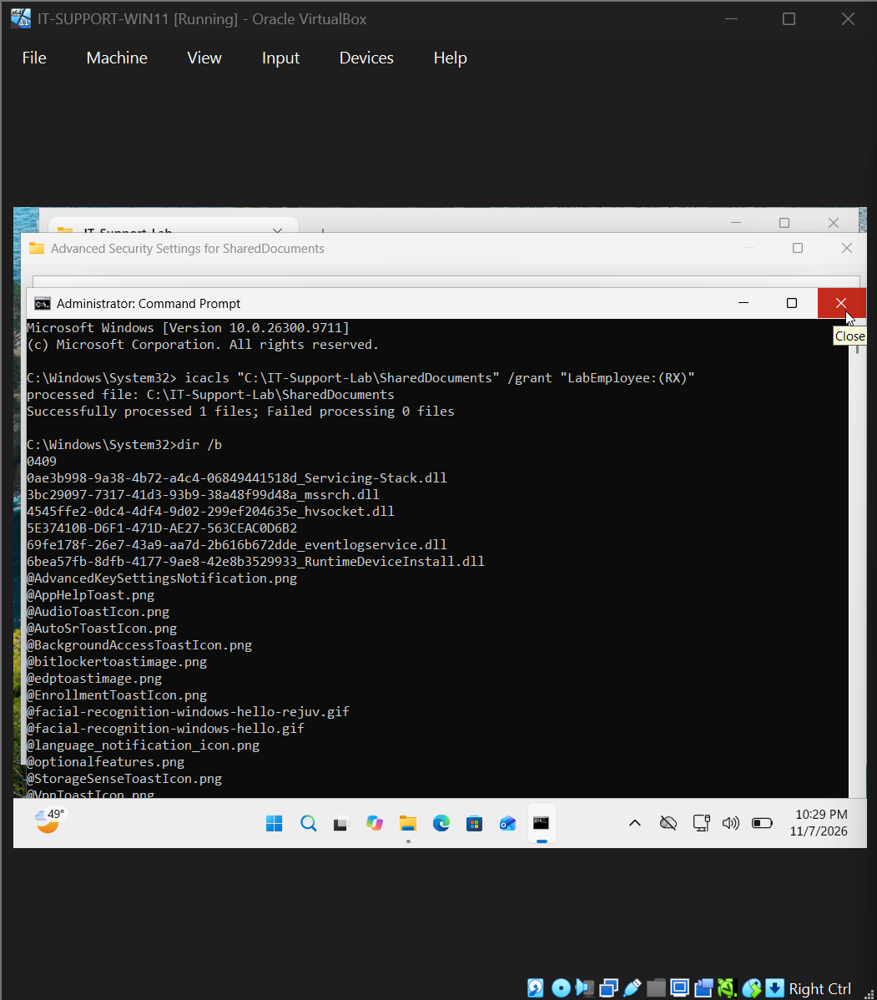

**Corrective Action:** Used `icacls` to grant the standard employee account Read & Execute access.

### Step 9 — Investigate a File Path Error

During command-line verification, an attempt was made to reference the document using:

`Company-Report.txt`

The command failed because the file could not be found under that name.

### Investigation

Executed:

`dir /b "C:\IT-Support-Lab\SharedDocuments"`

### Purpose

List the names of files and directories in the target folder using a simplified output format.

### Observed Result

The directory listing showed the actual filename:

`Company-Report.txt.txt`

### Technical Analysis

The failed command was caused by a filename mismatch.

The actual document contained two `.txt` extensions, while the command referenced a filename with only one.

The error was resolved by checking the directory contents and using the correct file path in subsequent commands.

This was a separate troubleshooting issue from the original NTFS access-denied condition.

### Evidence 09 — File Path Troubleshooting

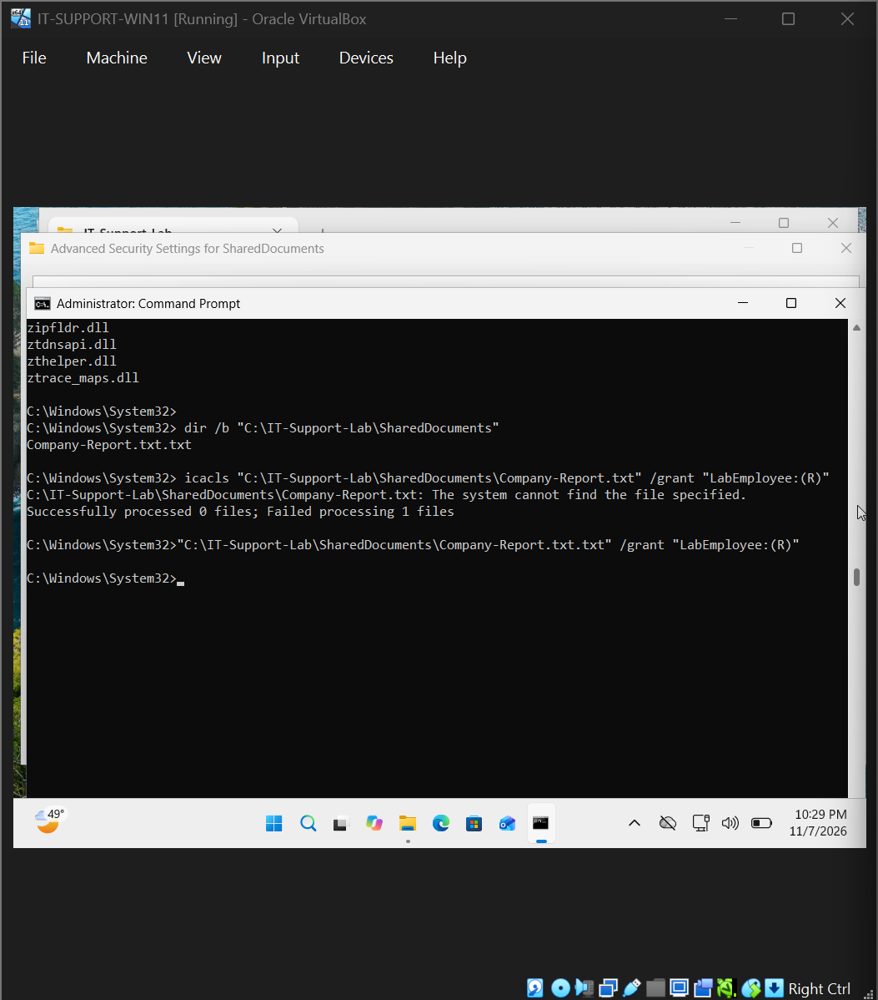

**Diagnostic Finding:** The command referenced an incorrect filename. Checking the directory listing established the correct document name.

### Step 10 — Verify the Updated Folder Permissions

Returned to the folder's Security settings and reviewed the resulting access control entries.

### Observed Permissions

| Account or Group | Permission |
|---|---|
| Administrators | Full Control |
| SYSTEM | Full Control |
| LabEmployee | Read & Execute |

### Technical Analysis

The resulting folder ACL included an access entry granting `LabEmployee` Read & Execute permissions.

Administrative and system access were preserved.

This configuration supported the intended least-privilege policy by granting the employee sufficient access to view authorized content without assigning Full Control.

### Evidence 10 — Updated NTFS Permissions

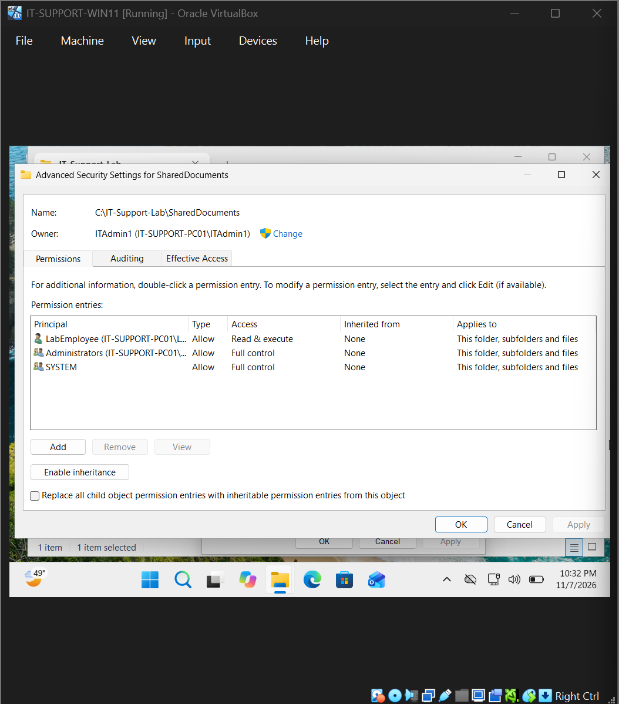

**Observation:** The folder ACL reflected the intended Read & Execute permission for the employee account.

## 8. Resolution Verification

### Step 11 — Test Document Access as the Standard User

Signed in to Windows as:

`LabEmployee`

Navigated to:

`C:\IT-Support-Lab\SharedDocuments`

Opened the document:

`Company-Report.txt.txt`

### Observed Result

The employee account successfully accessed the directory and opened the test document.

### Technical Analysis

This confirmed that the original access-denied condition had been resolved for the tested account.

The result was verified through an actual user operation rather than relying solely on the administrator's configuration screen.

### Evidence 11 — Employee Read Access Verified

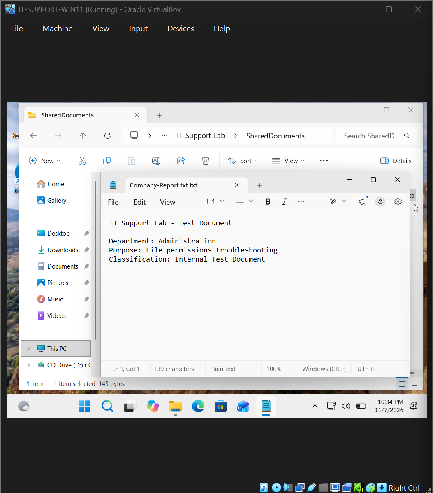

**Verification Finding:** The standard user was able to open and read the document after the permission changes.

### Step 12 — Verify Account Identity and File Permissions

Opened Command Prompt under the employee account.

Executed:

`whoami`

**Purpose:** Confirm which Windows account was running the verification commands.

**Observed Result:**

`it-support-pc01\labemployee`

This confirmed that the test was being performed using the standard employee account.

Next, executed:

`icacls "C:\IT-Support-Lab\SharedDocuments\Company-Report.txt.txt"`

**Purpose:** Inspect the access control entries associated with the test file.

### Observed File Permissions

The output included the following entries:

`BUILTIN\Administrators:(I)(F)`

`NT AUTHORITY\SYSTEM:(I)(F)`

`IT-SUPPORT-PC01\LabEmployee:(I)(RX)`

### Permission Interpretation

| Permission Indicator | Meaning |
|---|---|
| `(I)` | Inherited access control entry |
| `(F)` | Full Control |
| `(RX)` | Read & Execute |

### Technical Analysis

The file-level ACL showed that `LabEmployee` had an inherited Read & Execute permission entry.

Administrators and SYSTEM retained Full Control.

This provided command-line evidence that the document's access permissions were consistent with the intended employee access policy.

Checking the actual file ACL was important because granting permissions on a folder does not, by itself, prove that every child file has the same effective access.

### Evidence 12 — Account Identity and File ACL Investigation

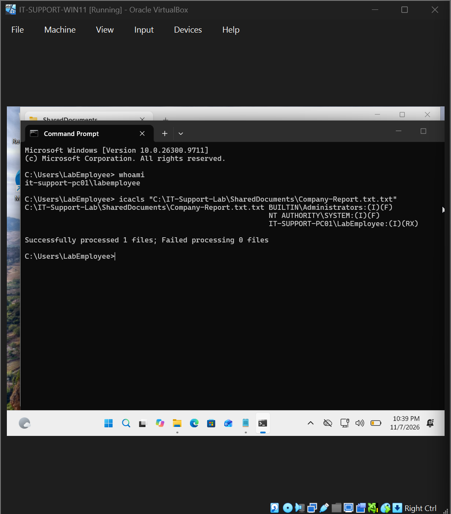

**Verification Finding:** The test was performed under the employee account, and the file ACL showed inherited Read & Execute permissions.

### Step 13 — Verify That File Modification Was Denied

While signed in as `LabEmployee`, executed:

`echo Testing write permissions. >> "C:\IT-Support-Lab\SharedDocuments\Company-Report.txt.txt"`

### Purpose

Attempt to append text to the existing document using the standard employee account.

The `>>` operator redirects command output to the end of a file.

If the user has appropriate write permissions, the text can be appended to the file.

### Observed Result

Command Prompt returned:

**Access is denied.**

### Technical Analysis

The failed append operation demonstrated that the employee account could not modify the document through the tested command.

This was consistent with the account's Read & Execute permissions.

The result was especially useful because it verified the permission boundary through an actual attempted write operation.

The employee could read the document but could not append content to it.

### Evidence 13 — Write Access Denied

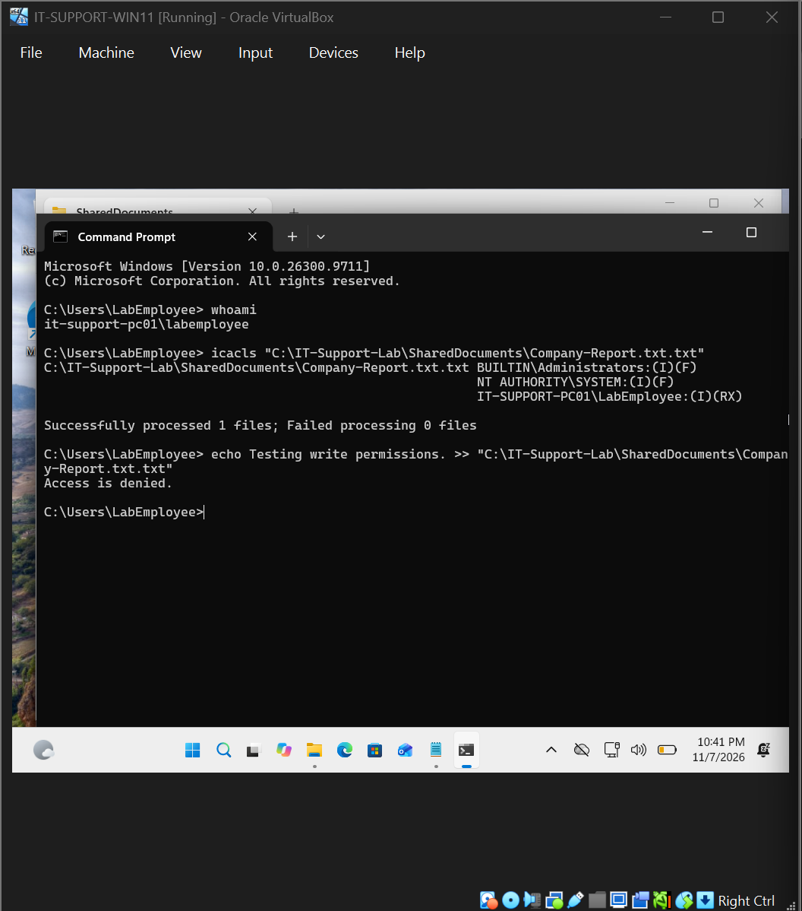

**Verification Finding:** The employee account had sufficient permissions to read the document but could not append changes to it.

## 9. Final Verification Results

| Verification Test | Expected Result | Observed Result | Status |
|---|---|---|---|
| Employee account type | Standard User | Standard account used | Passed |
| Initial restricted folder access | Denied | Access denied | Confirmed |
| Administrator access | Full Control | Preserved | Passed |
| Employee folder permission | Read & Execute | Granted | Passed |
| Employee document access | File opens successfully | Opened successfully | Passed |
| Active test account | `LabEmployee` | Confirmed with `whoami` | Passed |
| Document ACL | Read & Execute | `(I)(RX)` observed | Passed |
| Document append attempt | Access denied | Access denied | Passed |
| Original employee access issue | Resolved | Folder and file accessible | Passed |

### Final Assessment

The original access-denied condition was resolved by granting appropriate NTFS permissions to the standard employee account.

The final tests demonstrated that the employee could access and read the authorized document while being unable to append text to it.

These findings confirmed the intended read-only access behavior for the tested document and operation.

## 10. Technical Skills Demonstrated

### Windows User and Account Administration

- Created and used a standard local Windows account.
- Distinguished administrative privileges from standard-user permissions.
- Verified the active account identity using `whoami`.
- Tested file access from the affected user's security context.

### NTFS Permissions and Access Control

- Inspected file and folder ACLs.
- Identified inherited and explicit access entries.
- Disabled folder permission inheritance and modified access entries.
- Assigned Read & Execute permissions using a least-privilege approach.
- Distinguished between read access, modification rights, and Full Control.

### Command-Line Administration

- Used `icacls` to modify folder access permissions.
- Used `icacls` to inspect document-level ACLs.
- Used `dir /b` to investigate a filename mismatch.
- Used `whoami` to confirm the account executing verification commands.
- Used command-line output redirection to test write permissions.

### Troubleshooting and Problem Solving

- Reproduced an NTFS access-denied error.
- Investigated an unexpected Windows Security permission error.
- Used a command-line alternative after a graphical permission operation failed.
- Diagnosed and corrected a filename mismatch.
- Confirmed the solution through successful read access and denied write access.

### Technical Documentation

- Recorded the initial permission configuration.
- Preserved evidence of the access restriction.
- Documented unexpected troubleshooting problems and corrective actions.
- Verified permissions using both ACL inspection and actual user operations.

## 11. Lessons Learned

### Least Privilege Should Be Verified Through Actual User Access

An access control configuration should provide users with the permissions required for their responsibilities without unnecessarily granting broader rights.

In this scenario, Read & Execute was sufficient for the employee's intended task.

### Graphical Errors Require Further Investigation

The Windows Security error demonstrated that permission-management operations can fail or produce unexpected results.

Using `icacls` provided another way to inspect and modify NTFS permissions.

The successful command-line operation still required follow-up verification.

### Exact File Paths Matter

The filename mismatch between `Company-Report.txt` and `Company-Report.txt.txt` caused an additional command failure.

Inspecting the directory contents helped identify the discrepancy and correct the command.

### Configuration Checks and Functional Tests Serve Different Purposes

An ACL showing Read & Execute permissions provides useful configuration evidence.

However, testing the affected user's actual ability to open the file and attempting a write operation provide stronger evidence of how the permissions behave.

The combination of ACL inspection, successful read access, and denied write access established that the final configuration met the intended requirements.

## 12. Incident Closure

| Closure Requirement | Result |
|---|---|
| Standard employee account configured | Completed |
| Test folder and document created | Completed |
| Original NTFS permissions investigated | Completed |
| Restricted access simulated | Completed |
| Employee access-denied error reproduced | Completed |
| Windows Security permission error investigated | Completed |
| NTFS permissions adjusted using ICACLS | Completed |
| Filename mismatch identified and corrected | Completed |
| Employee Read & Execute permissions confirmed | Completed |
| Employee document access verified | Passed |
| Employee identity verified | Passed |
| File ACL inspected | Passed |
| Unauthorized append operation blocked | Passed |
| Evidence documented | Completed |
| **Final Status** | **Resolved and Verified** |

---

**Project:** Windows & Network Troubleshooting Lab

[Return to Main Project README](../README.md)
