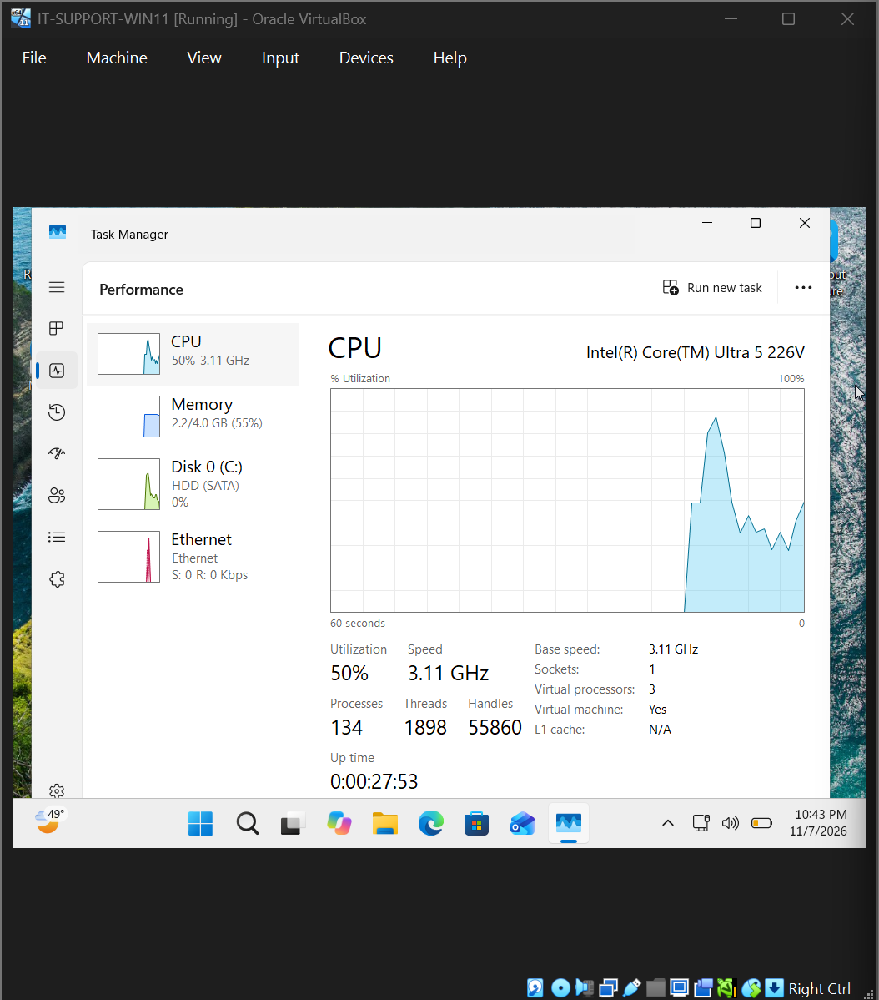
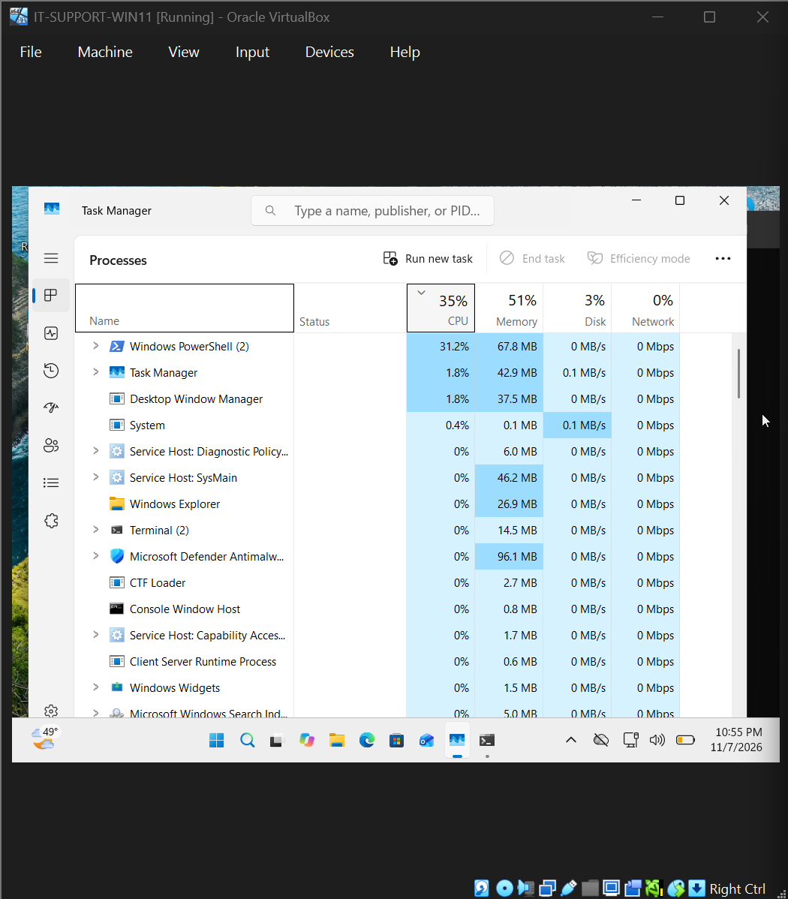
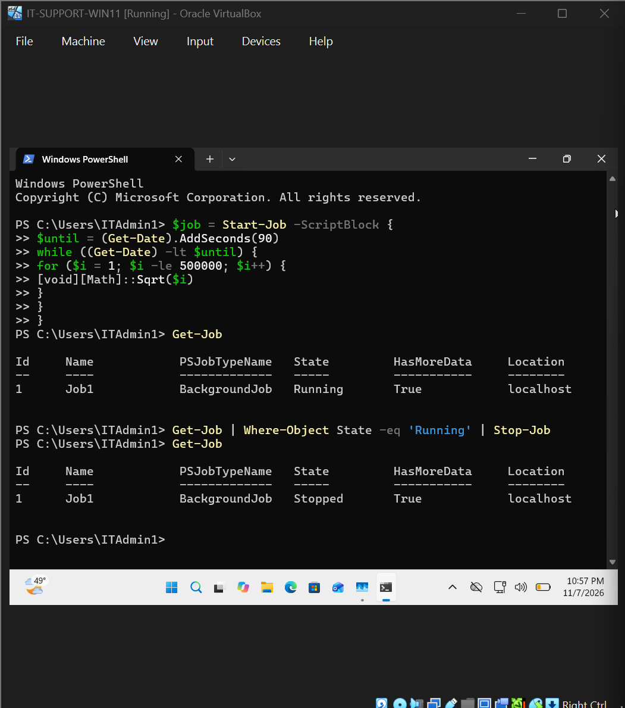
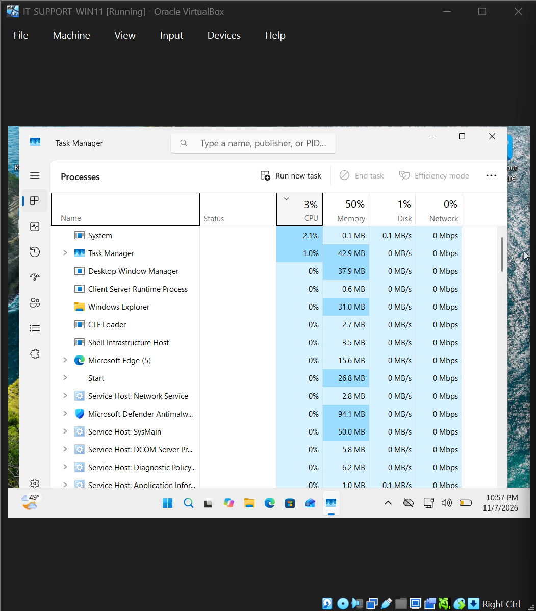

# Ticket 007 | High CPU Usage & PowerShell Process Investigation

**Incident Category:** Windows Troubleshooting — System Performance & Process Management

**Environment:** Windows 11 Pro | Oracle VirtualBox

**Workstation:** `IT-SUPPORT-PC01`

**Incident Type:** Simulated IT Support Ticket

**Final Status:** Resolved and Verified

---

## 1. Incident Summary

Created a controlled CPU-intensive PowerShell background job, identified its processor usage in Task Manager, and stopped it to verify recovery.

### Incident at a Glance

| Item | Finding |
|---|---|
| Reported issue | Elevated CPU usage during a controlled PowerShell workload |
| Diagnostic evidence | Task Manager showed Windows PowerShell (2) at **31.2% CPU**, with **35%** total system CPU usage; `Get-Job` confirmed the job was `Running` |
| Root cause | A deliberately started PowerShell background job repeatedly performed mathematical calculations |
| Tools used | Windows Task Manager, `Start-Job`, `Get-Job`, `Where-Object`, `Stop-Job` |
| Corrective action | Stopped the running background job using PowerShell |
| Verified result | `Get-Job` showed `Stopped`; total CPU usage subsequently measured **3%**, down **32 percentage points** from the active-workload reading |

**Testing scope:** These are individual Task Manager observations, not sustained performance averages. The lab did not simulate memory pressure or an unexpected production application failure.


## 2. Technical Environment

| Component | Configuration |
|---|---|
| Operating System | Windows 11 Pro (64-bit) |
| Virtualization Platform | Oracle VirtualBox |
| Workstation | `IT-SUPPORT-PC01` |
| Allocated Memory | 4 GB RAM |
| Virtual Processors | 3 |
| Performance Monitoring Tool | Windows Task Manager |
| Command-Line Tool | Windows PowerShell |
| Workload Type | CPU-intensive PowerShell background job |
| Job Management Commands | `Start-Job`, `Get-Job`, `Stop-Job` |
| Workload Duration Setting | 90 seconds |
| Observed CPU Before Stopping Job | 35% total |
| Observed CPU After Stopping Job | 3% total |

The exercise was performed in a virtual machine to safely simulate resource-intensive activity without intentionally placing a production workstation under load.

## 3. Initial Performance Investigation

### Step 1 — Examine System Resource Usage

Opened Windows Task Manager and navigated to the **Performance** tab.

Reviewed CPU utilization, memory usage, and the number of running processes.

### Observed Initial Snapshot

| Performance Metric | Observed Value |
|---|---|
| CPU Utilization | Approximately 50% |
| Memory Usage | Approximately 2.2 GB of 4 GB |
| Memory Utilization | Approximately 55% |
| Running Processes | 134 |

### Technical Analysis

Task Manager provides real-time visibility into how Windows uses processor and memory resources.

The initial inspection established the available system resources and provided experience interpreting workstation performance metrics.

The observed CPU percentage represented a momentary measurement. CPU utilization can change rapidly depending on active processes and background Windows activity.

Therefore, the initial 50% reading was recorded as a preliminary performance snapshot, not treated as a stable idle baseline or evidence of the later PowerShell workload.

The investigation subsequently focused on identifying and measuring the deliberately generated CPU workload.

### Evidence 01 — Initial System Performance Snapshot



**Observation:** Task Manager displayed the workstation's initial CPU, memory, and process information before the controlled CPU workload was investigated.

## 4. Incident Reproduction

### Step 2 — Generate a Controlled CPU Workload

Opened Windows PowerShell and created a background job designed to perform repeated mathematical calculations.

The following script was used:

```powershell
$job = Start-Job -ScriptBlock {
    $until = (Get-Date).AddSeconds(90)

    while ((Get-Date) -lt $until) {
        for ($i = 1; $i -le 50000; $i++) {
            [void][Math]::Sqrt($i)
        }
    }
}
```

### Command Explanation

| PowerShell Component | Purpose |
|---|---|
| `Start-Job` | Starts a background job |
| `-ScriptBlock` | Defines the commands executed by the job |
| `Get-Date` | Retrieves the current system date and time |
| `.AddSeconds(90)` | Sets the workload's intended duration |
| `while` | Repeats the workload until the time condition is met |
| `for` | Repeats the calculation 50,000 times per outer iteration |
| `[Math]::Sqrt($i)` | Performs a square-root calculation |
| `[void]` | Discards the calculation result |

### Technical Explanation

The script creates a CPU-bound workload by repeatedly executing mathematical operations.

Unlike an operation primarily waiting for disk or network activity, the repeated calculation loop requires processor time.

Using `Start-Job` allows PowerShell to execute the workload in a background job, which can be managed through PowerShell's job-management commands.

The 90-second condition limits the workload's intended runtime. The job can also finish naturally when the specified period expires.

An initial job completed before the intended performance capture was obtained, so the workload was repeated to observe its resource usage while active.

This was a controlled troubleshooting simulation, not evidence of an unexpected application crash or malicious process.

## 5. Diagnostic Investigation

### Step 3 — Identify the CPU-Intensive Process

Opened Task Manager and selected the **Processes** tab.

Examined the CPU column to identify processes consuming significant processor resources.

### Observed Results

| Performance Metric | Observed Value |
|---|---|
| Process Group | Windows PowerShell (2) |
| PowerShell CPU Utilization | 31.2% |
| Total System CPU Utilization | 35% |
| System Memory Utilization | Approximately 51% |

### Technical Analysis

Task Manager identified Windows PowerShell as a major contributor to the observed CPU utilization.

The Processes tab associated 31.2% CPU usage with the Windows PowerShell process group.

Total system CPU usage was approximately 35% during the same observation.

These measurements were consistent with the intentionally generated calculation workload.

The distinction between process CPU usage and total CPU utilization is important:

- Process CPU usage describes the portion of processor resources attributed to a process or process group.
- Total CPU utilization includes activity across the system.

Because the PowerShell workload had been deliberately started for this exercise, its purpose and origin were known.

In a real support investigation, additional context would be needed before stopping an unfamiliar process, including whether it was performing legitimate business tasks or supporting another application.

### Evidence 02 — High CPU Process Identified



**Diagnostic Finding:** Windows PowerShell was consuming 31.2% CPU while total system CPU utilization was approximately 35%.

### Step 4 — Investigate PowerShell Background Jobs

Returned to the PowerShell session and executed:

`Get-Job`

**Purpose:**

Display PowerShell background jobs associated with the session and inspect their execution status.

### Observed Result

The CPU workload's background job appeared with the status:

**Running**

### Technical Analysis

The job status confirmed that the PowerShell workload was still active during the investigation.

This provided a connection between the controlled background job and the resource-intensive PowerShell activity observed in Task Manager.

Task Manager identified the process consuming CPU resources, while `Get-Job` provided information about the PowerShell task responsible for the simulated workload.

Using both tools helped establish a more complete understanding of the problem before corrective action was taken.

## 6. Root Cause Analysis

### Confirmed Root Cause

**An intentionally created PowerShell background job was performing repeated CPU-intensive calculations.**

The workload repeatedly executed mathematical operations for a configured period, consuming processor resources.

Task Manager showed elevated CPU usage associated with Windows PowerShell, and the job-management commands confirmed that the background task was running.

### Supporting Evidence

| Evidence | Interpretation |
|---|---|
| PowerShell calculation workload was started | Established the source of the simulated incident |
| Task Manager showed PowerShell using 31.2% CPU | Identified a major contributor to CPU utilization |
| Total CPU utilization was 35% | Established system CPU usage during the active workload |
| `Get-Job` returned Running | Confirmed that the background job was active |
| `Stop-Job` changed the job state to Stopped | Confirmed the job was stopped |
| Total CPU usage subsequently decreased to 3% | Supported successful removal of the controlled workload |

### Root Cause Conclusion

The resource-intensive PowerShell background job was identified as the cause of the observed CPU consumption during the simulation.

The issue did not require changing the virtual machine's CPU allocation, reinstalling Windows, or modifying unrelated applications.

Because the workload was a known background job created for the exercise, it could be stopped through PowerShell's job-management commands.

This provided a targeted corrective action without relying on a forced termination of the entire PowerShell application.

## 7. Corrective Actions

### Step 5 — Stop the Running PowerShell Job

Opened PowerShell and executed:

```powershell
Get-Job | Where-Object State -eq 'Running' | Stop-Job
```

### Purpose

Identify running PowerShell background jobs in the session and issue a stop request.

### Command Breakdown

| Command Component | Purpose |
|---|---|
| `Get-Job` | Retrieves background jobs |
| `Where-Object` | Filters objects based on a condition |
| `State -eq 'Running'` | Selects jobs with a Running status |
| `Stop-Job` | Stops the selected background jobs |
| `|` | Passes command output to the next command |

### Technical Analysis

The command selected running PowerShell background jobs and passed them to `Stop-Job`.

In this lab, the relevant running job was the intentionally generated CPU workload.

This avoided making unrelated system configuration changes.

In a real environment, it would be preferable to identify a specific job before stopping it, especially if multiple legitimate background jobs were running in the same session.

### Step 6 — Verify the Job Stopped

Executed:

`Get-Job`

### Observed Result

The background job's status changed from:

**Running**

To:

**Stopped**

### Technical Analysis

The updated job state confirmed that the background workload had been stopped.

This was the first verification step.

However, confirming that a job stopped does not independently establish that the system's CPU usage returned to an acceptable level.

A follow-up performance measurement was needed.

### Evidence 03 — PowerShell Background Job Stopped



**Corrective Action:** Stopped the running PowerShell job and confirmed that its state changed to Stopped.

## 8. Resolution Verification

### Step 7 — Recheck CPU Utilization

Returned to Windows Task Manager and inspected the **Performance** tab after stopping the PowerShell job.

### Observed Results

| Performance Metric | After Corrective Action |
|---|---|
| Total CPU Utilization | Approximately 3% |
| Memory Utilization | Approximately 50% |
| PowerShell Background Job | Stopped |

### Technical Analysis

After the background job was stopped, Task Manager showed total CPU utilization of approximately 3%.

This was substantially lower than the 35% total CPU usage observed while the PowerShell workload was active.

The reduction was consistent with the CPU-intensive job no longer performing calculations.

Memory utilization remained around 50%, showing that the exercise did not involve a significant memory-consumption workload.

### Evidence 04 — CPU Usage Restored



**Verification Finding:** Total CPU utilization decreased to approximately 3% after the PowerShell background job was stopped.

### Before and After Comparison

| Metric | During Active Workload | After Stopping Job |
|---|---|---|
| PowerShell Job State | Running | Stopped |
| Total CPU Utilization | 35% | 3% |
| PowerShell CPU Utilization | 31.2% | Not separately recorded after stopping |
| Memory Utilization | Approximately 51% | Approximately 50% |

The recorded total CPU utilization decreased by **32 percentage points**, from 35% to 3%.

These were Task Manager observations taken at different moments, rather than averages from a prolonged performance-monitoring session.

### Final Verification Results

| Verification Test | Expected Result | Actual Result | Status |
|---|---|---|---|
| CPU-intensive workload created | Job starts | Workload observed | Passed |
| High CPU process identified | Responsible process visible | Windows PowerShell identified | Passed |
| Running job confirmed | Running status | Running | Passed |
| Stop command executed | Job stopped | Stopped | Passed |
| Background job state verified | Stopped | Stopped | Passed |
| CPU utilization rechecked | Lower after stopping workload | 3% total CPU | Passed |
| Memory stress testing | Outside scope | Not performed | Not Tested |

**Final Assessment:** The controlled CPU-intensive PowerShell workload was stopped successfully, and follow-up monitoring confirmed that total CPU utilization had decreased significantly.

## 9. Technical Skills Demonstrated

### Windows Performance Monitoring

- Used Task Manager to inspect CPU and memory utilization.
- Examined the Processes tab to identify resource-intensive applications.
- Compared system performance measurements before and after corrective action.
- Distinguished process-level CPU utilization from total system CPU usage.

### PowerShell Administration

- Created a controlled background job using `Start-Job`.
- Used `Get-Job` to inspect background job status.
- Filtered running jobs using `Where-Object`.
- Stopped the background workload using `Stop-Job`.
- Verified the resulting job state through PowerShell.

### Process and Resource Troubleshooting

- Investigated a CPU-intensive workload.
- Connected Task Manager process observations to PowerShell job activity.
- Identified the known workload responsible for elevated processor usage.
- Applied a targeted corrective action.
- Verified that stopping the workload was followed by reduced CPU utilization.

### Technical Documentation

- Recorded the initial performance observations.
- Documented the workload used to reproduce the incident.
- Captured the CPU-intensive process in Task Manager.
- Preserved the PowerShell job-management evidence.
- Recorded the final CPU measurement after the corrective action.

## 10. Lessons Learned

### High CPU Usage Requires Process-Level Investigation

Elevated CPU utilization alone does not identify the responsible application or task.

Task Manager's Processes tab helps determine which processes are consuming processor resources.

In this exercise, PowerShell was identified as a major contributor to system CPU utilization.

### Background Jobs Can Be Investigated Separately

PowerShell provides commands for managing background jobs.

Using `Get-Job` allowed the workload's execution state to be inspected, while `Stop-Job` provided a targeted method for ending the known task.

Understanding the relationship between a process and its underlying work can help avoid unnecessary system changes.

### Corrective Actions Require Follow-Up Verification

Stopping the background job was only part of the resolution.

The investigation also required checking the job state and returning to Task Manager to confirm that CPU utilization had decreased.

The reduction from 35% to 3% provided measurable evidence that the workload had stopped consuming significant processor resources.

### Performance Measurements Must Be Interpreted in Context

CPU usage changes continuously.

A single Task Manager reading represents system activity at a particular moment and should not automatically be treated as a long-term performance average.

The initial snapshot, active-workload measurements, and post-resolution readings were used to document the observed system behavior during the exercise.

The test demonstrated successful control of a known CPU-intensive process. It did not establish the cause of any unrelated CPU activity or investigate sustained memory pressure.

## 11. Incident Closure

| Closure Requirement | Result |
|---|---|
| Initial performance inspected | Completed |
| CPU-intensive workload created | Completed |
| Resource-intensive process identified | Completed |
| PowerShell background job investigated | Completed |
| Root cause established | Completed |
| Running background job stopped | Completed |
| Job state verified | Passed |
| CPU utilization rechecked | Passed |
| Total CPU reduced from 35% to 3% | Verified |
| Memory-pressure testing | Not Performed |
| Evidence documented | Completed |
| **Final Status** | **Resolved and Verified** |

---

**Project:** Windows & Network Troubleshooting Lab

[Return to Main Project README](../README.md)
